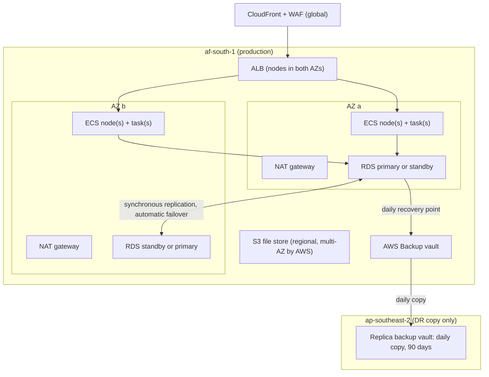

# SEC-004 — HA and DR replication support

| Workbook | Area | Priority | Status (repo-verified) | Evidence ID | Test ID | Risk ID |
|---|---|---|---|---|---|---|
| 04 IT Infrastructure | IT Infrastructure & Operations | P1 | Partially Implemented | SEC-004-E01 | SEC-004-T01 | R-SEC-004 |

## Requirement
No single point of failure in the region; replicated recoverability out of
the region. Acceptance: killing one availability zone in a test causes no
data loss and less than one minute of client-visible disruption.

## How MoDocument meets it today
Pre-production: Terraform written and validated, **not deployed**. Fact
IDs refer to [A8-infra-checks.md](../evidence/A8-infra-checks.md).

| Element | In-region HA | Proof |
|---|---|---|
| Database | Multi-AZ synchronous standby with automatic failover in production (`multi_az = true`); staging single-AZ | `infra/terraform/modules/rds/main.tf`; `infra/terraform/envs/production/main.tf` (TF-21) |
| App tier | Auto Scaling group across both private app subnets (min 2 nodes); service minimum 2 tasks; ALB health checks eject a task after 3 failed checks at 30 s; the ECS service scheduler balances tasks across AZs by default (no explicit placement strategy) | `infra/terraform/modules/ecs-app/main.tf` (TF-62, TF-70, TF-73) |
| Deployments | Minimum healthy 100 %, circuit breaker with rollback | TF-73 |
| Egress | One NAT gateway per AZ in production (staging one shared) | `infra/terraform/modules/network/main.tf` (TF-12) |
| Load balancer and edge | ALB across both public subnets; CloudFront global | TF-71, TF-84 |
| File store | S3 regional storage | TF-50 |
| Single points of failure left | None found in the production request path in code. Staging is deliberately single-AZ (database, one NAT gateway). Rate-limit counters live in each task's memory, so losing a task only resets its counters (`src/main/resources/application.yml`, `modocument.ratelimit` comment) | TF-12, TF-21 |

**Out of region (DR):** only **backup copies**. AWS Backup copies the
daily database recovery point to ap-southeast-2 and keeps it 90 days
(`infra/terraform/modules/backups/main.tf`, TF-42). There is no
cross-region read replica, no replicated file store (TF-54) and no
standby stack: a region loss means rebuilding the stack in another region
from Terraform and restoring the copy (procedure R2 in
[storage-backup-recovery-map.md](../policies/storage-backup-recovery-map.md)).
This is the cost decision recorded in the workbook risk register.

**RTO/RPO:** in-region RPO ≤ 5 minutes (PITR), region-loss RPO ≤ 24 hours
(daily copy) (`docs/security/sla-and-status.md`). A region-loss RTO is
**not documented** anywhere in the repository; the 4-hour (repo) or 2-hour
(workbook) RTO assumes the region survives. `TO CONFIRM (organisational)`.

**Replication-lag monitoring:** Multi-AZ RDS replicates synchronously (no
lag metric to watch); no cross-region replica exists, so the workbook's
"replication-lag graph" does not apply. Backup-copy job success is not
alarmed in Terraform (gap).

## Questionnaire answer (final)
MoDocument is not yet in production. At go-live it will run in two AWS
availability zones in Cape Town: the PostgreSQL database uses Amazon RDS
Multi-AZ with a synchronous standby and automatic failover; the
application runs at least two containers on at least two servers spread
across both zones behind a load balancer with health checks; each zone has
its own outbound NAT gateway. For loss of the whole region, the database
backup is copied daily to a second AWS region (Sydney) and kept 90 days;
recovery from a region loss means rebuilding the environment from our
infrastructure code and restoring that copy, so it is a restore, not an
automatic failover. A zone-failure test will be run before go-live.
Evidence: SEC-004-E01.

## Evidence SEC-004-E01
| Item | Location | Kind (repo / run / to confirm) |
|---|---|---|
| Topology diagram | this page; [security-architecture.md](../policies/security-architecture.md) | repo |
| Multi-AZ, ASG, service, NAT, backup copy (code) | `infra/terraform/modules/rds/main.tf`; `infra/terraform/modules/ecs-app/main.tf`; `infra/terraform/modules/network/main.tf`; `infra/terraform/modules/backups/main.tf` | repo |
| Terraform validate | [A8-infra-checks.md](../evidence/A8-infra-checks.md) §1 | run (2026-10-19) |
| Replication-lag monitoring graph | — | Not applicable (synchronous Multi-AZ; no cross-region replica) |
| Last failover-test note (AZ failure, RDS reboot with failover) | — | `NOT IN REPO (live cloud)` — never run |

## Test SEC-004-T01
- **Procedure:** (1) static: confirm Multi-AZ, two-AZ subnets, min 2
  nodes/tasks, NAT per AZ and the cross-region copy in the production
  code; validate; (2) acceptance: in staging with `db_multi_az = true`
  (the README rehearsal flag) and then production, force an RDS failover
  (`aws rds reboot-db-instance --force-failover`) and stop the nodes of one
  AZ while a probe polls `GET /api/probe/synthetic` every few seconds;
  measure disruption and check data.
- **Expected result:** no data loss and less than one minute of
  client-visible disruption.
- **Actual result:** (1) all present in code, validate passed; region
  loss has no standby (by design); (2) not run — no AWS environment.
- **Result:** Partial.
- **Tester:** Agent A8 (static re-performance); human sign-off required.
- **Date:** 2026-10-19.

## Gap and remediation
| Gap | Type | Action | Owner | Target date | Phase |
|---|---|---|---|---|---|
| Not deployed; zone-failure test never run | Build | Deploy; run T01 in staging, then production | IT Infrastructure — Bhavish Nobeen | Pre-go-live, date to set (`TO CONFIRM (organisational)`) | Day 60 |
| Region-loss RTO not documented | Doc/Org | State the region-loss RTO in the DR plan (PRIV-007) after a timed rebuild rehearsal | Bhavish Nobeen | `TO CONFIRM (organisational)` | Day 60 |
| File store not replicated (DEF-4) | Build | Cross-region copy of the file store | Bhavish Nobeen | with the first apply | Day 60 |
| Backup-copy failures not alarmed | Build | EventBridge rule on failed AWS Backup copy jobs → alert topic | Bhavish Nobeen | with the first apply | Day 60 |

## Risk R-SEC-004
- **Risk:** a single AZ or node failure causes a client-visible outage;
  loss of the Cape Town region is unrecoverable within the RTO.
- **Cause:** untested failover; no warm standby out of region (cost
  decision).
- **Mitigation:** Multi-AZ database and app tier, zone-failure test,
  documented and rehearsed region rebuild. Likelihood, impact and
  residual are set in MO-031.

## To confirm
- `NOT IN REPO (live cloud)`: failover-test note; backup-copy job history.
- `TO CONFIRM (organisational)`: region-loss RTO; acceptance of the no-standby cost decision; RTO value (2 h or 4 h).
