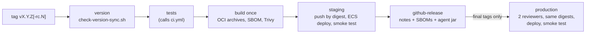

# MO-009 Part 2 — Release and deployment, configuration and secrets

Part of the [MO-009 Developer & Technical Documentation set](../mo-009-developer-technical-documentation.md). The authoritative procedure is `docs/release/runbook.md`; this part summarises it for a new developer and points at the files. Command results: [A2-verified-commands.md](../evidence/A2-verified-commands.md).

## 1. Release and deployment

### 1a. Versioning

- One SemVer version for the API, the SPA, the agent, connector-core and the changelog: `pom.xml`, `agent/pom.xml`, `connector-core/pom.xml`, `frontend/package.json` (+ lock) and the newest dated `CHANGELOG.md` heading (`docs/release/runbook.md` §1; `scripts/bump-version.sh` header).
- `scripts/check-version-sync.sh` fails when they differ; CI runs it on every push (`.github/workflows/ci.yml`). **Verified (C8)**: `Version-sync: OK 1.2.0`.
- `scripts/bump-version.sh X.Y.Z` is the only supported way to change the version: it checks the tree, sets the version in every file, turns `## [Unreleased]` into `## [X.Y.Z] - <date>` and re-checks. It commits and tags nothing (`scripts/bump-version.sh` header).
- `CHANGELOG.md` is packaged into the jar and served by `GET /api/system/release-notes` (`pom.xml` `release-notes` execution).

### 1b. Cutting a release (runbook §1)

1. Describe the change under `## [Unreleased]` in `CHANGELOG.md`.
2. `scripts/bump-version.sh X.Y.Z`; commit `Release X.Y.Z`; merge to `main`.
3. Tag `vX.Y.Z-rc.1` and push the tag → staging only, GitHub pre-release.
4. After the staging soak (minimum 48 h, `docs/release/runbook.md` §3), tag `vX.Y.Z` on the **same commit** → staging, GitHub Release, then the production job waits for approval.

### 1c. The pipeline (`.github/workflows/release.yml`)

- Each image is built **once**; staging and production run the same digests, pushed with `skopeo --preserve-digests` and verified (`.github/workflows/release.yml` header; `scripts/release/push-oci.sh`).
- The task definition pins both images by digest; `scripts/release/ecs-deploy.sh` rolls the service and fails when the ECS circuit breaker rolls back.
- Smoke test: `GET /api/probe/synthetic` must report the release version with the database up, three times in a row (`scripts/release/smoke-test.sh`; `docs/release/runbook.md` §2).
- AWS access is GitHub OIDC only, one deploy role per environment (`infra/terraform/modules/ci-oidc/main.tf`); configuration is in the GitHub environments `staging` and `production` (`AWS_REGION`, `AWS_DEPLOY_ROLE_ARN`, `ECR_REGISTRY`, `ECR_APP_REPOSITORY`, `ECR_FRONTEND_REPOSITORY`, `ECS_CLUSTER`, `ECS_SERVICE`, `ECS_TASK_FAMILY`, `PUBLIC_BASE_URL`), checked by `scripts/release/require-env.sh`.
- Approvals: the `production` environment has two required reviewers and "prevent self-review" (`docs/release/runbook.md` §3 and §7). Whether these GitHub settings are switched on: `TO CONFIRM (organisational)`.
- The Connector Agent is built and scanned in the same run, attached to the GitHub Release and pushed to `ghcr.io/<owner>/modocument-agent` (`.github/workflows/release.yml` header).
- No release has run against AWS: the accounts do not exist yet (`docs/release/runbook.md` status note). Real deployments: `NOT IN REPO (live cloud)`.

### 1d. Rollback

- **Automatic:** the ECS deployment circuit breaker (`rollback = true` in `infra/terraform/modules/ecs-app/main.tf`) returns to the last steady task definition (`docs/release/runbook.md` §4).
- **Manual:** Actions → *Deploy* (`.github/workflows/deploy.yml`) with `version` = the previous release and the target `environment`; production still needs its reviewers. The same workflow with the current version re-applies a Terraform-only task-definition change.
- The schema is never rolled back ("Never use Flyway undo"); this is why migrations are expand-only (§2). The rollback rehearsal is written in `docs/release/runbook.md` §12 and has not been run (`NOT IN REPO (live cloud)`).
- Hotfix: branch from the release tag, bump the patch version, `vX.Y.Z+1-rc.1`, soak at least 4 h (`docs/release/runbook.md` §5).

## 2. Database migrations

| Rule | Proof |
|---|---|
| Flyway owns the schema in every PostgreSQL environment; Hibernate only validates (`ddl-auto: validate`) | `src/main/resources/application.yml` (`spring.flyway`, `spring.jpa`) |
| Migrations run as the schema owner (`MODOCUMENT_FLYWAY_USERNAME`/`_PASSWORD`), the app as `modocument_app` | `src/main/resources/application.yml`; `docker-compose.yml` |
| Each workstream owns a block of versions; files from V20 on are named `V{n}__ws{NN}_{description}.sql` | `src/main/resources/db/migration/RANGES.md` |
| From V200 on, a release may only **expand**; drops, renames, type changes, `SET NOT NULL` and `VALIDATE CONSTRAINT` ship one release later with a `-- contract: expanded-in vX.Y.Z` header | `docs/release/migration-policy.md` |
| `FlywayVersionRangeTest` and `MigrationPolicyTest` (with `MigrationSqlLinter`) enforce ranges and the expand/contract rule in `mvn verify` | `src/test/java/com/modocument/release/FlywayVersionRangeTest.java`, `src/test/java/com/modocument/release/MigrationPolicyTest.java`; **verified (C5)**: 7 and 58 tests pass |
| Never edit or rename an applied migration (checksum validation stops the app) | `docs/release/migration-policy.md` "Version ranges and naming" |
| `CREATE INDEX CONCURRENTLY` needs a `V{n}__….sql.conf` with `executeInTransaction=false`; Flyway's lock is a session lock | `src/main/resources/db/migration/V270__ws27_perf_indexes.sql.conf`; `src/main/resources/application.yml` (`transactional-lock: false`) |
| `afterMigrate__rls_enforce.sql` runs after every migrate | `src/main/resources/db/migration/afterMigrate__rls_enforce.sql` |

Adding a migration: pick the next free version in your range, write expand-only SQL, run `mvn -Dtest='FlywayVersionRangeTest,MigrationPolicyTest' test`, then `-Ppostgres-it` (or CI's `backend-postgres` job) to apply the whole chain on real PostgreSQL. A reviewer asks "does release N−1 still work on this schema?" (`docs/release/migration-policy.md`).

## 3. Infrastructure deployment (Terraform)

`infra/terraform/README.md` is the procedure: state backend first, then staging, then production; secret values set out-of-band before the full apply; `bootstrap_admin_enabled = false` after the first admin exists; `enforce_backup_locks=true` only after the restore drill (gate D6). Status: `terraform validate` passed on 9–10 Oct 2026 per that README; `plan`/`apply` are pending (`NOT IN REPO (live cloud)`). Terraform is not installed in this container, so validation was not re-run for this set.

## 4. Configuration layout

| File | Role | Proof |
|---|---|---|
| `src/main/resources/application.yml` | Production defaults; every value overridable by an environment variable (`${ENV:default}`). Separate YAML documents add the `structured-logs` profile, AI client resilience and the integration hub wiring | file |
| `src/main/resources/application-local.yml` | `local` profile: imports `./application-local-secrets.yml`, `permit-dev-paths: true`, admin MFA not forced, template changes without maker/checker, Swagger UI on, `extraction.store: sql` | file |
| `src/main/resources/application-scale.yml` | `scale` profile: MongoDB extraction store and Kafka (requires a `-Pscale` build); transport security not production-grade (TODO SEC-028 in the file) | file |
| `src/main/resources/application-test.yml` | `test` profile: H2, Flyway off, fixed dev-only keys | file |
| `application-local-secrets.yml.example`, `application-oidc.yml.example` | Templates at the repository root for local secrets and OIDC providers | files |
| `src/main/resources/logback-spring.xml` | Console pattern with `[requestId] [u:userId b:bankId]`, redaction converters | file |

Profiles in use: none (production defaults), `local`, `scale`, `test`, `structured-logs` (`src/main/resources/application.yml`; `README.md` "Configuration").

### 4a. Environment variables

`application.yml` reads 128 distinct `MODOCUMENT_*` variables (grep count, C11), plus legacy and library names (`AIFILES_OPENAI_*`, `MAPPING_*`, `PARSING_*`, `OCR_VISION_*`, `DOCLING_BASEURL`, `EXTRACTION_*`, `SPRING_*`). The groups a developer meets first:

| Group | Main variables | Notes / proof |
|---|---|---|
| Database | `MODOCUMENT_DB_URL`, `_USERNAME`, `_PASSWORD`, `_SSLMODE`, `_POOL_MAX`; `MODOCUMENT_FLYWAY_USERNAME`, `_PASSWORD` | Default URL `jdbc:postgresql://localhost:5432/modocument?sslmode=prefer`; production uses `require` or `verify-full` (`application.yml`; `README.md` "Production deployment checklist") |
| Crypto keys (secrets) | `MODOCUMENT_JWT_SECRET`, `MODOCUMENT_MFA_KEY`, `MODOCUMENT_CONNECTOR_KEY` (+ `_VERSION`, `MODOCUMENT_CONNECTOR_RETIRED_KEYS`) | JWT and MFA keys ≥ 32 bytes, required; connector key = base64 of 32 bytes, required when guardrails are enforced (`docker-compose.yml`; `docs/integration/secrets.md`) |
| First-run accounts | `MODOCUMENT_BOOTSTRAP_ADMIN_*`, `MODOCUMENT_BOOTSTRAP_SECOND_ADMIN_*`, `MODOCUMENT_PLATFORM_ADMIN_EMAILS` / `_PASSWORDS` | §2c of Part 1 |
| AI | `MODOCUMENT_AI_BASE_URL`, `_API_KEY`, `_MODEL`, `_READ_TIMEOUT`, `_RETRY_*`; `OCR_VISION_ENABLED` | Local Ollama by default; external endpoints are opt-in (`application.yml`; `README.md` "AI integration") |
| Storage | `MODOCUMENT_STORAGE_BACKEND` (`local`/`s3`), `_ROOT`, `MODOCUMENT_STORAGE_S3_*` | `application.yml` `modocument.storage` |
| Web | `MODOCUMENT_CORS_ALLOWED_ORIGINS`, `MODOCUMENT_TRUSTED_PROXY_CIDRS` (nginx), `MODOCUMENT_MTLS_TRUSTED_PROXY_CIDRS`, `MODOCUMENT_API_DOCS_ENABLED` | `application.yml`; `frontend/Dockerfile`; `docs/security/web-hardening.md` |
| Rate limits and caps | `MODOCUMENT_RATELIMIT_*`, `MODOCUMENT_EXPORT_CAP_*` | `application.yml` `modocument.ratelimit`, `modocument.export` |
| Alerts, SIEM, logs | `MODOCUMENT_ALERTS_*`, `MODOCUMENT_ALERT_*` thresholds, `MODOCUMENT_SIEM_*`, `MODOCUMENT_LOG_FORMAT` | `application.yml`; [Part 5](05-operations-logging-backup.md) |
| Guardrails | `MODOCUMENT_SETTINGS_ENFORCE_GUARDRAILS` (Terraform sets `true`) | `infra/terraform/modules/ecs-app/main.tf` |

The README "Configuration" table lists the most-used keys with their defaults.

### 4b. Runtime-editable settings vs. deployment configuration

| Kind | Where it lives | Who changes it | Proof |
|---|---|---|---|
| Editable settings (sign-in and passwords, rate limits, data protection, security alerts, AI and extraction, integrations) | Catalogue in code (`SettingDefinitions`); changed values in the `BankSetting` table (V200) | Bank admin (`/api/admin/settings`, `settings:write`) or platform owner (`/api/platform/settings`, `platform:settings`); SECURITY-tier changes are maker/checker | `docs/settings/catalogue.md`; `src/main/java/com/modocument/infrastructure/settings/SettingDefinitions.java` |
| Resolution order | bank override → platform value → shipped default (the Spring property) | — | `docs/settings/catalogue.md` "How a value is resolved" |
| Hard limits | Code; a shipped default outside them is a WARN, or a refused boot with `MODOCUMENT_SETTINGS_ENFORCE_GUARDRAILS=true` | — | `src/main/java/com/modocument/infrastructure/settings/SettingsStartupCheck.java` |
| Never in the UI | Secrets and wiring: JWT/MFA keys, DB credentials, AI key/URL/model, webhook/SIEM/OIDC secrets and URLs, CORS, SSRF allow-list, storage root, cron expressions, multipart limits | Deployment configuration only | `docs/settings/catalogue.md` "Never in the UI"; `SettingsCatalogueSafetyTest` |

Each task polls a revision counter every `MODOCUMENT_SETTINGS_POLL_INTERVAL_MS` (default 5000 ms) and reloads its snapshot (`application.yml` `modocument.settings`). `SettingsCatalogueDocTest` keeps `docs/settings/catalogue.md` equal to the code (**verified (C5)**: passes).

## 5. Feature switches a developer should know

| Switch | Default | Proof |
|---|---|---|
| `extraction.store` (`EXTRACTION_STORE`) | `sql` | `src/main/resources/application.yml` |
| `ocr.vision.enabled` (`OCR_VISION_ENABLED`) | `false` | `src/main/resources/application.yml` |
| `mapping.llm-fallback-enabled` | `true` | `src/main/resources/application.yml` |
| `modocument.doccreation.section-ai-enabled` | `true` | `src/main/resources/application.yml` |
| `modocument.storage.backend` | `local` (`s3` on ECS) | `src/main/resources/application.yml`; `infra/terraform/modules/ecs-app/main.tf` |
| `springdoc.api-docs.enabled` (`MODOCUMENT_API_DOCS_ENABLED`) | `true` (token needed outside `local`) | `src/main/resources/application.yml` |
| `management.endpoints.web.exposure.include` | `health` only | `src/main/resources/application.yml` |

## 6. Secrets handling

| Rule | How it is enforced | Proof |
|---|---|---|
| No secret is committed, not even for local development | `.env` is gitignored; `.env.example` holds placeholders only; the `local` profile reads the JWT key from the environment or the gitignored `application-local-secrets.yml` | `.gitignore`; `.env.example`; `src/main/resources/application-local.yml` |
| Leaks are caught | gitleaks over the full history on every push, PR and weekly | `.github/workflows/security.yml`; `.gitleaks.toml` |
| Required secrets have no defaults | Compose refuses to start; the app refuses missing/short/known-default JWT secrets, and a missing MFA key in production | `docker-compose.yml`; `src/main/java/com/modocument/api/config/SecurityConfig.java`; `README.md` "Authentication" |
| Files instead of values | Every sensitive variable accepts `<NAME>_FILE` (Docker/ECS secrets); setting both forms with different values is refused | `src/main/java/com/modocument/infrastructure/security/SecretFileEnvironmentPostProcessor.java`; `docker-compose.yml` comment |
| AWS | Secrets Manager shells per environment (`jwt`, `mfa_key`, `connector_key`, `db_app`, bootstrap and platform-admin secrets); values set out-of-band; injected into the ECS task by ARN | `infra/terraform/envs/production/main.tf`; `infra/terraform/envs/staging/main.tf`; `infra/terraform/modules/ecs-app/main.tf` |
| Bank connection credentials | Write-only; sealed with AES-256-GCM under a per-bank key derived from `MODOCUMENT_CONNECTOR_KEY`; rotation with `MODOCUMENT_CONNECTOR_KEY_VERSION` and `MODOCUMENT_CONNECTOR_RETIRED_KEYS` | `docs/integration/secrets.md`; `src/main/java/com/modocument/application/port/integration/SecretVault.java`; `src/main/java/com/modocument/infrastructure/integration/secrets/ConnectorSecretVault.java` |
| AGENT-mode connections | MoDocument stores only a `secretRef`; the value stays on the bank's agent host | `docs/integration/secrets.md`; `docs/integration/agent.md` |
| Inventory | Every key and certificate with owner and rotation | `docs/security/key-certificate-register.md` |
| CI | Run-scoped secrets generated per E2E run and masked; AWS via OIDC, no static keys | `.github/workflows/ci.yml` job `e2e`; `infra/terraform/modules/ci-oidc/main.tf` |

Generate values with `openssl rand -base64 48` (JWT, MFA), `openssl rand -base64 32` (connector key), `openssl rand -hex 24` (database passwords) (`.env.example`; `docs/integration/secrets.md`).

Whether the production Secrets Manager entries exist and hold values: `NOT IN REPO (live cloud)`.
