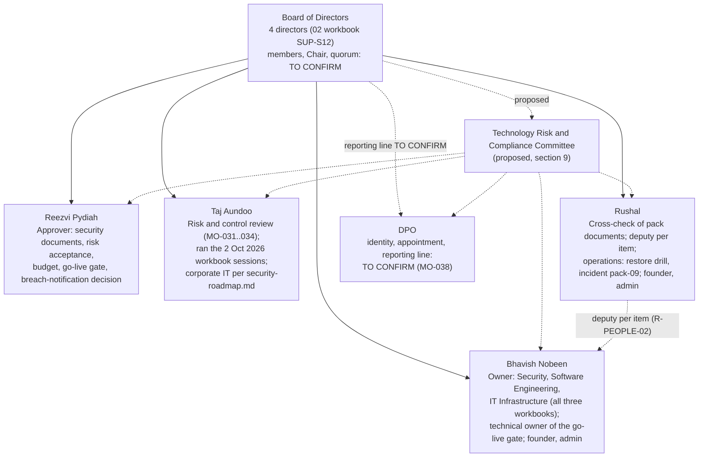

# MO-001 — Governance Structure

**Task MO-001: Define company governance structure.** Deliverable: Governance Structure document with organisation chart, approval matrix and RACI.
**Linked DPO task:** MO-038 (confirm the DPO appointment, independence and reporting line).

This is the foundation document of the pack. The approval matrix (§4) and the RACI (§7) are the single place where people's roles are named. Every other pack document uses these role names. Product role names come from the code (`src/main/java/com/modocument/domain/model/Role.java`).

Where this page says **Source**, the fact comes from the checklist, a workbook row or a repo file. The list is in `docs/compliance/evidence/A1-governance-sources.md`. **Proposed — confirm** means a recommendation from this pack that the Board has not yet approved. `TO CONFIRM (organisational)` means a fact only the company can supply.

---

## 1. Purpose and scope

**Purpose.** This document records how MO Intelligence governs MoDocument. It covers:

- who sits on the Board and what each named person does;
- who approves policies, contracts, client go-lives, releases, access, risk acceptance and spend;
- where the DPO sits;
- which forum oversees technology risk and compliance;
- how the product enforces two-person control in code.

**Scope.**

- **In scope:** MO Intelligence's people and decision rights for the MoDocument platform. This includes the technology-risk programme (the three workbooks: 02 Security, 03 Software Engineering and 04 IT Infrastructure & Operations) and the go-live of client banks.
- **Out of scope:** the internal governance of a client bank. Each bank runs its own users through the bank roles in §6 and is the owner of its own approvals inside its tenant.

**Current position.** On 2 Oct 2026 the workbooks recorded MoDocument as **pre-production**: nothing deployed, no bank data. Source: 03/04 workbook readme and Comments. The go-live controls in this document are therefore built and tested in the repository, but their live operation is `NOT IN REPO (live cloud)`.

## 2. Document control

| Field | Value |
|---|---|
| Document | MO-001 Governance Structure |
| Version | 1.0 draft |
| Date | 2026-10-19 |
| Status | Draft. Not yet approved. |
| Owner (author) | Bhavish Nobeen. Source: checklist MO-001, "Governance structure by bhavish". |
| Cross-check | Rushal. Source: checklist MO-001 "Reviewer / Approver". |
| Approval | Board of Directors. Source: checklist MO-001 "Reviewer / Approver"; "Management Approval: Yes". |
| DPO confirmation | The DPO confirms that §8 (DPO role, independence and reporting line) is correct. Source: checklist MO-001 "DPO Action"; linked task MO-038. |
| Review cycle | Annually. Also on any change of director, DPO, approver or product role (proposed — confirm). |
| Proposed approval date | 2026-11-02 (proposed). This aligns with the "Next Review" date in the 02 workbook "Policies & Documents" sheet. |

| Version | Date | Change | By |
|---|---|---|---|
| 1.0 draft | 2026-10-19 | First version, written from the checklist, the three workbooks and the repository | Bhavish Nobeen (owner); drafted for the pack |

## 3. Organisation chart

### 3.1 What the sources say about the Board

- The company has **four directors**. Source: 02 workbook, SUP-S12 Required Action: "security@ to all four directors".
- **Bhavish Nobeen and Rushal are the two founders** and the only two administrators across AWS, Azure and the MoDocument admin console. Source: 02 workbook, SEC-017 Comments: "2 admins (Bhavish, Rushal) … no grants ever made beyond the 2 founders".
- The directors review the security roadmap monthly. Source: 02 workbook, SEC-041 Required Action: "monthly director review".
- MO-031 calls for a "joint session with **all directors and the DPO**". Source: checklist MO-031.
- The workbooks do not say who the four directors are. Four people are named in the workbooks: Bhavish Nobeen, Rushal, Reezvi Pydiah and Taj Aundoo. That they are the four directors is **not stated**: `TO CONFIRM (organisational)`.
- Not stated anywhere: the Chair, board seats and terms, the quorum, the meeting cadence and each director's formal title. Each is `TO CONFIRM (organisational)`.

### 3.2 Chart

Solid lines are roles stated in a source. Dotted lines are reporting lines that no source states (`TO CONFIRM (organisational)`). The committee is proposed (§9).

The solid arrows from the Board show that each person works under Board oversight. They do not claim a board seat or a line-management relationship. Both are `TO CONFIRM (organisational)`.

### 3.3 Plain-table fallback

| Person / body | Roles given by the sources | Source | Board seat | Reports to |
|---|---|---|---|---|
| Board of Directors | Approves MO-001, MO-032 and MO-034. Receives the risk reporting from MO-032. Reviews the security roadmap monthly. | checklist MO-001, MO-032, MO-034; 02 workbook SEC-041 | 4 directors (02 workbook SUP-S12); names `TO CONFIRM (organisational)` | — |
| Reezvi Pydiah | Approves security documents (PRIV-011, SEC-040, SEC-041 "Approval"). Accepts residual risks (R-SHARED-01, R-AI-01 / gate C11, R-REGION-01). Approves the privileged-access grant record (SEC-017). Sets budget lines and decides the pen-test budget (SEC-041, SEC-009). Approves MO-017 and MO-019. Approver of the go-live gate. Decides breach notifications. Signs off DPIAs and the retention/DSR procedure. Signs off DR (D7) and decides the certification path (SEC-038). | workbooks 02/03/04; checklist MO-017, MO-019; `docs/security/incident-response-stub.md`; `docs/security/dpia-template.md`; `docs/security/retention-and-dsr.md` (sign-off role "Accountable executive, MoDocument security program"); `docs/security/security-roadmap.md` ("risk & compliance sign-offs"); `README.md` go-live table | `TO CONFIRM (organisational)` | `TO CONFIRM (organisational)` |
| Taj Aundoo | Risk and control review of MO-031, MO-032, MO-033 and MO-034. Ran the 2 Oct 2026 working sessions that filled all three workbooks. Named in the repo as owner of corporate IT items: the E5 security mailbox, SUP-S10 DMARC and SUP-S09 MDM. | checklist MO-031…034; workbook readme sheets; `docs/security/security-roadmap.md`; `SECURITY.md` | `TO CONFIRM (organisational)` | `TO CONFIRM (organisational)` |
| Bhavish Nobeen | Owner of every control in the Security, Software Engineering and IT Infrastructure workbooks ("Security — Bhavish Nobeen", "Software Engineering — Bhavish Nobeen", "IT Infrastructure — Bhavish Nobeen"). "Management decision 2 Oct 2026 to assign all fixes to Bhavish". Also holds the DR Lead and Data & Privacy items (R-PEOPLE-02). Technical owner of the go-live gate. Author of MO-001 and lead of MO-031…034. Founder and one of the two administrators. | workbooks 02/03/04 (Gap Assessment and Roadmap Owner; Risk Register R-PEOPLE-02); checklist MO-001, MO-031…034; 02 workbook SEC-017 | `TO CONFIRM (organisational)` | `TO CONFIRM (organisational)` |
| Rushal | Cross-checks MO-001, MO-009 and MO-016…019. Named deputy for each of Bhavish's items (R-PEOPLE-02, R-SCHED-01). The other administrator and a founder (SEC-017). On weekly on-call rotation with Bhavish (04 workbook). Named in the repo as operations owner: restore drill D4–D6, load-test run E7, SIEM reference test, status-page updates, and owner of the full incident-response pack ("pack-09"). | checklist; 02/03 workbook Risk Register; 04 workbook Comments; `docs/security/security-roadmap.md`; `docs/security/incident-response-stub.md`; `docs/security/sla-and-status.md` | `TO CONFIRM (organisational)` | `TO CONFIRM (organisational)` |
| The DPO | Involved in MO-001, MO-018, MO-019 and MO-031…034 (checklist "DPO Action"). Linked tasks MO-038, MO-048, MO-056 and MO-059. | checklist | not applicable / `TO CONFIRM (organisational)` | `TO CONFIRM (organisational)` (§8) |
| "Pack 07 reviewer" | The independent reviewer of every evidence item and questionnaire answer. Must be independent of the Security owner. | workbooks 02/03/04 "Evidence Register" and "Questionnaire Answers" Reviewer | — | Which person fills this role: `TO CONFIRM (organisational)` |

**Name note.** Some repo documents give Rushal a surname. The workbooks do not, so this pack uses "Rushal" only.

### 3.4 Conflicts between sources (to be settled when the Board approves)

| Topic | Source A | Source B | Pack position |
|---|---|---|---|
| security@ mailbox / SUP-S12 | 02 workbook SUP-S12: Bhavish sets it up | `SECURITY.md` and `README.md`: gate E5 owner Taj Aundoo | `TO CONFIRM (organisational)`. The RACI (§7) shows Taj Aundoo as R for the mailbox and Bhavish Nobeen as R for the policy text, proposed. |
| SPF/DKIM/DMARC (SUP-S10) | 04 workbook R-SPOOF-01: "Bhavish sets up SPF/DKIM/DMARC by 9 Oct" | `README.md` / `docs/security/security-roadmap.md`: owner Taj Aundoo | `TO CONFIRM (organisational)` |
| DR / BCDR sign-off (D7) | `README.md` and `docs/security/security-roadmap.md`: Reezvi Pydiah | Go-Live Security Gate PDF (2 Oct 2026): D7 owner Taj Aundoo | `TO CONFIRM (organisational)`. RACI A = Reezvi Pydiah (repo is the source of truth). |
| DR Lead | 02 workbook R-PEOPLE-02: Bhavish holds "DR Lead" | `README.md`: restore drill D4–D6 owner Rushal | The two are compatible: Bhavish leads DR and Rushal runs the drill. Confirm. |
| Load test (E7) vs stress test (MO-016/017) | checklist MO-016/017: Bhavish's task, Rushal reviews | `README.md` / `docs/security/security-roadmap.md`: E7 load-test run owner Rushal | RACI: Bhavish Nobeen R for plan and report, Rushal R for the run. Confirm. |

## 4. Decision-making and approval authority matrix

**Maker** proposes. **Approver** decides. **Enforced / evidenced by** is where the decision leaves a record. A decision that has no source is marked proposed.

| # | Decision | Maker | Approver | Enforced / evidenced by | Basis |
|---|---|---|---|---|---|
| D1 | Company-level policies and this governance framework: governance, risk management, incident, data protection, information security policy | Bhavish Nobeen; cross-check Rushal; DPO consulted on privacy content | **Board of Directors** | Signed version table in each document; `docs/compliance/policies/` | Source: checklist MO-001, MO-032, MO-034 (Board approval). Applying it to all company policies is proposed — confirm. |
| D2 | Security documents and standards: CIA table, security matrices, security roadmap | Bhavish Nobeen | **Reezvi Pydiah** | 02 workbook "Policies & Documents" (Approval = Reezvi Pydiah, version 1.0 draft, next review 2026-11-02); `docs/security/cia-controls-table.md`, `docs/security/threat-control-matrix.md`, `docs/security/security-roadmap.md` | Source: 02 workbook PRIV-011, SEC-040, SEC-041 |
| D3 | Contracts, NDAs, data-processing agreements with client banks and vendors | `TO CONFIRM (organisational)` | `TO CONFIRM (organisational)`. Proposed: a director the Board names, with the DPO consulted on data-processing terms. | Not in repo | proposed — confirm |
| D4 | Client (bank) go-live: a bank may send data | Bhavish Nobeen (technical owner); the independent Pack 07 reviewer confirms each gate item | **Reezvi Pydiah** (gate approver). If any item fails: written risk acceptance by management. | Go-Live Security Gate sign-off block (PDF, 2 Oct 2026) | Source: Go-Live Security Gate PDF ("No partial go-live … management formally accepts the risk in writing") |
| D5 | Bank onboarding inside the product (create, suspend, break-glass admin) | A platform admin (`PLATFORM_ADMIN`) submits `BANK_CREATE`, `BANK_SUSPEND` or `BANK_ADMIN_ADD` | A **second** platform admin (`change:approve` + `platform:banks`); self-approval refused | `src/main/java/com/modocument/domain/model/ChangeType.java`, `src/main/java/com/modocument/application/usecase/BankCreateChangeApplier.java`, `src/main/java/com/modocument/application/security/ChangeAudience.java`; audit `BANK_ONBOARDED` (`docs/platform/platform-owner.md`) | Source: code. That D4 must be approved before D5 is submitted is proposed — confirm. |
| D6 | Production release | Release manager pushes tag `vX.Y.Z` after the 48 h staging soak | A reviewer of the GitHub `production` environment who is **not** the person who pushed the tag ("Prevent self-review") | `.github/workflows/release.yml` job `production` (environment `production`); `docs/release/runbook.md` §3 and §7. The environment settings themselves are `NOT IN REPO (live cloud)`. | Source: repo. Who the reviewers are: `TO CONFIRM (organisational)`. Proposed: Bhavish Nobeen and Rushal; also Reezvi Pydiah, so that a third person can approve when both engineers made the release. |
| D7 | Code change merged to `main` | Author (PR) | A second person (CODEOWNERS approval; required checks green) | `.github/CODEOWNERS`, `docs/security/branch-protection.md`, `.github/pull_request_template.md`. Branch-protection settings are a GitHub setting, `NOT IN REPO (live cloud)`. | Source: repo. CODEOWNERS today lists one GitHub account: see §10 finding F3. |
| D8 | Security-setting change | Bank: `ADMIN` with `settings:write` submits `SETTING_UPDATE`. Platform: `PLATFORM_ADMIN` submits `PLATFORM_SETTING_UPDATE`. | Bank: another `change:approve` holder of the same bank. Platform: a second platform admin. | `docs/security/maker-checker.md`; `src/main/java/com/modocument/domain/model/ChangeType.java`; audit `SECURITY_SETTING_UPDATED` / `PLATFORM_SETTING_UPDATED` | Source: code |
| D9 | Privileged access (cloud consoles, AWS/Azure admin, `PLATFORM_ADMIN`) | Bhavish Nobeen | **Reezvi Pydiah** approves the written grant record. In the product, the second platform admin approves the `USER_CREATE` / `USER_ROLE_CHANGE`. | 02 workbook SEC-017 ("one-page grant record (approved by Reezvi)"); `src/main/java/com/modocument/application/security/RoleAssignmentPolicy.java` | Source: 02 workbook SEC-017 + code |
| D10 | Bank user access (joiner, mover, leaver, password/MFA reset) | Bank `ADMIN` (`user:admin`) | A different `change:approve` holder of the same bank (`APPROVER` or `ADMIN`) | `docs/security/jml-runbook.md`; `docs/security/maker-checker.md`; `src/test/java/com/modocument/api/MakerCheckerIntegrationTest.java` | Source: code |
| D11 | Risk acceptance (residual risk, interim exceptions) | Risk owner (Bhavish Nobeen for every workbook risk) | **Reezvi Pydiah**. Proposed: risks rated High or Critical in MO-031 also go to the Board. | Workbook Risk Register "Acceptance Required" (R-SHARED-01, R-AI-01, R-REGION-01); `docs/security/ai-controls.md` (residual AI risks); `README.md` gate C11 | Source: workbooks 03/04. Board escalation is proposed — confirm. |
| D12 | Accepted vulnerability (scanner finding not fixed) | Bhavish Nobeen | Reezvi Pydiah (as D11); a reviewed `.trivyignore` entry with expiry and ticket | `docs/release/runbook.md` §2 | Source: repo (mechanism). Approver proposed — confirm. |
| D13 | Spend and budget | Bhavish Nobeen (needs) | **Reezvi Pydiah** sets budget lines (first: the penetration test, decision by 31 Oct 2026). Thresholds above which the Board must approve: `TO CONFIRM (organisational)`. | 02 workbook SEC-041, SEC-009; `docs/security/security-roadmap.md` (E4) | Source: 02 workbook. Thresholds `TO CONFIRM (organisational)`. |
| D14 | Incident declaration | Anyone reports to the security mailbox and to Rushal; on-call (Bhavish Nobeen / Rushal) triages | Rushal declares (owner of the incident pack) — proposed — confirm | `docs/security/incident-response-stub.md`; alerts `docs/security/alerting-and-export-caps.md` | Source: stub (reporting path). Declaration authority is proposed. |
| D15 | Breach notification to banks, regulator and data subjects | Rushal (facts) with the DPO (assessment and draft) | **Reezvi Pydiah** decides; nothing goes out without that decision | `docs/security/incident-response-stub.md` step 5 | Source: stub. DPO involvement is proposed (the stub does not name the DPO, §10 F1). |
| D16 | Data-subject request (DSR) on a bank's data | Bank `ADMIN` runs search, export and erase in its own bank (`user:admin`) | Requester identity and legal basis checked by the bank, which is the controller of its data; MO Intelligence DPO consulted when a request reaches MO Intelligence directly (proposed) | `docs/security/retention-and-dsr.md`; `src/main/java/com/modocument/api/controller/DataSubjectController.java`; audit `DSR_SEARCH`, `DSR_EXPORTED`, `DSR_ERASED` | Source: code. Controller/processor split `TO CONFIRM (organisational)` with the DPO. |
| D17 | Retention schedule and DSR procedure | Bhavish Nobeen | **Reezvi Pydiah** (sign-off block) | `docs/security/retention-and-dsr.md` "Sign-off" | Source: repo |
| D18 | DPIA for a new processing purpose, data category, recipient or storage location | Bhavish Nobeen (proposed) | **Reezvi Pydiah** (risk-owner sign-off), after DPO advice (proposed) | `docs/security/dpia-template.md` §5 | Source: repo. DPO step is proposed (§10 F2). |
| D19 | Egress allow-list (data leaving production) | Bhavish Nobeen (define) | Reezvi Pydiah (sign off). In the product, a bank's private destination needs `EGRESS_RULE_APPROVE` by a second platform admin. | `README.md` gate D3; `docs/security/maker-checker.md` (`EGRESS_RULE_APPROVE`) | Source: repo |
| D20 | Certification path (ISO 27001 or SOC 2) | Bhavish Nobeen | Reezvi Pydiah | `docs/security/security-roadmap.md` (SEC-038) | Source: repo |

## 5. How the product enforces governance in code

The approval rules above are not only policy. The application blocks one person from both asking for and approving a critical change, and it records every decision in an append-only trail.

| Mechanism | What it guarantees | Proof |
|---|---|---|
| **Maker/checker (dual control)** | Each critical change is stored as a `PendingChange` in status `REQUESTED`. It is applied only when a **different** user with `change:approve` approves it. Self-approval returns 409 and writes a `SELF_APPROVAL_BLOCKED` audit row (DENIED) in its own transaction. 17 change types are covered: user create, role change, disable, password/MFA reset, template update/delete, bank and platform security settings, bank create/suspend/break-glass admin, integration connections, outbound flows, API clients, agents and egress rules. | `src/main/java/com/modocument/domain/model/ChangeType.java`; `src/main/java/com/modocument/domain/entity/PendingChange.java`; `src/main/java/com/modocument/application/usecase/PendingChangeUseCase.java`; `docs/security/maker-checker.md`; `src/test/java/com/modocument/api/MakerCheckerIntegrationTest.java` |
| **Checker audience** | Each change type has exactly one audience: **Bank** (another approver of the same bank) or **Platform** (a second platform admin only). The switch is exhaustive, so a new type does not compile until it is placed. | `src/main/java/com/modocument/application/security/ChangeAudience.java`; `src/test/java/com/modocument/application/usecase/PendingChangeAudienceTest.java` |
| **Segregation of duties** | One role per user, so there are no toxic role combinations. Operation-level conflicts: maker ≠ checker (`CHANGE_APPROVAL`), and document releaser ∉ {author, submitter} (`DOC_RELEASE`). A nightly scan re-checks stored data and audits `SOD_VIOLATION_FOUND`. | `docs/security/role-catalogue-and-sod.md`; `src/main/java/com/modocument/application/security/SodPolicy.java`; `src/main/java/com/modocument/infrastructure/sod/SodScanJob.java`; `src/test/java/com/modocument/application/security/SodPolicyTest.java`; `src/test/java/com/modocument/api/DocReleaseSodIntegrationTest.java` |
| **Platform-owner model: two platform admins** | MO Intelligence staff sign in only to one dedicated platform bank, as `PLATFORM_ADMIN`. That role has no access to any bank's data. Bootstrap needs exactly two distinct platform admins. Disabling or demoting one that would leave fewer than two is refused (`MIN_ACTIVE_PLATFORM_ADMINS = 2`). TOTP is mandatory. Every platform write except reactivation is maker/checker between the two. | `docs/platform/platform-owner.md`; `src/main/java/com/modocument/application/security/RoleAssignmentPolicy.java`; `src/main/java/com/modocument/infrastructure/bootstrap/BootstrapPlatformRunner.java`; `src/main/java/com/modocument/application/usecase/UserAdminUseCase.java`; `src/main/java/com/modocument/api/security/PermissionChecker.java`; `src/main/resources/db/migration/V210__ws21_platform_bank.sql` |
| **Bank onboarding needs two approvers** | A new bank needs at least one `ADMIN` and at least two first users who can approve (`ADMIN` or `APPROVER`). This means the bank can run its own maker/checker from day one. | `src/main/java/com/modocument/application/usecase/BankCreateChangeApplier.java` |
| **Release approvals** | Production deploys run only through the `production` environment. The runbook sets "Required reviewers: 2 people, Prevent self-review", a 48 h staging soak, and a tag ruleset under which only release managers create `v*` tags. Rollbacks through `deploy.yml` need the same reviewers. | `.github/workflows/release.yml`; `.github/workflows/deploy.yml`; `docs/release/runbook.md` §3, §4, §7. The applied GitHub settings are `NOT IN REPO (live cloud)`. |
| **Branch protection** | No direct push to `main`. One required approval with Code Owner review, so the author cannot approve. Required checks: CI and security scans. The documented setting is that administrators may not bypass these rules. | `docs/security/branch-protection.md`; `.github/CODEOWNERS`; `.github/workflows/ci.yml`; `.github/workflows/security.yml`. The applied ruleset is `NOT IN REPO (live cloud)`. |
| **Audit of decisions** | The append-only `AuditEvent` table: UPDATE/DELETE/TRUNCATE are revoked from the app role, and triggers block them. It records who asked (`CHANGE_REQUESTED`), who approved (`CHANGE_APPROVED`, with the checker as actor of the domain row), refusals (`SELF_APPROVAL_BLOCKED`), access reviews (`ACCESS_REVIEW_GENERATED`), DSR steps and bank lifecycle events. | `docs/security/audit-events.md`; `src/main/resources/db/migration/V14__audit_event.sql`; `src/test/java/com/modocument/pgit/AuditAppendOnlyPgIT.java`; `src/main/java/com/modocument/application/audit/AuditActions.java`; `src/test/java/com/modocument/application/audit/AuditActionCatalogueDocTest.java` |
| **Alerting on governance events** | `privileged-change` (role changes, MFA removal, DSR export/erase, resets) and `platform-change` (bank lifecycle, platform settings, egress approvals) fire immediately. | `docs/security/alerting-and-export-caps.md` |

## 6. Company roles and product roles

### 6.1 Product role catalogue (the code's vocabulary)

The `Role` enum has six values, in privilege order for the four bank roles (`src/main/java/com/modocument/domain/model/Role.java`). Permissions per role are pinned in `docs/security/role-permission-matrix.csv`. The test `src/test/java/com/modocument/application/security/RolePermissionMatrixTest.java` fails the build if `src/main/java/com/modocument/application/security/RolePermissions.java` differs from the CSV.

| Product role | Held by | Governance-relevant permissions (CSV) |
|---|---|---|
| `ADMIN` | Client bank: application owner / IT administrator | `user:admin`, `change:approve`, `doc:release`, `settings:read/write`, `integration:admin`, `template:publish`, `audit:read`, `siem:read`, `metrics:read` plus all domain read/write |
| `APPROVER` | Client bank: supervisor / four-eyes checker | `change:approve`, `doc:release`, `audit:read`, plus all `*:read` |
| `READ_WRITE` | Client bank: operations staff / report author (maker) | all domain `*:write`, `export:run`, `file:upload`, `ai:use`, `doc:generate`, `integration:run` |
| `READ_ONLY` | Client bank: auditor, controller, second-line risk | all domain `*:read`, `profile:self` |
| `PLATFORM_ADMIN` | MO Intelligence staff, only in the platform bank | `platform:read/banks/settings/announce`, `lookup:admin`, `user:admin` and `change:approve` (own platform bank only), `audit:read`, `siem:read`. No domain permission. |
| `API_CLIENT` | A bank system (machine principal); never a person | `integration:ingest/results/docs/events`, `agent:connect` |

### 6.2 Mapping people to product roles

| Person | Product role | Basis |
|---|---|---|
| Bhavish Nobeen | `PLATFORM_ADMIN` (one of the two required). Also an AWS/Azure administrator and a repository administrator. | 02 workbook SEC-017 (one of the "2 admins … MoDocument Admin"). The mapping to `PLATFORM_ADMIN` is proposed — confirm. Which accounts are seeded is deployment configuration (`MODOCUMENT_PLATFORM_ADMIN_EMAILS`, `docs/platform/platform-owner.md`): `NOT IN REPO (live cloud)`. |
| Rushal | `PLATFORM_ADMIN` (the second; checker for Bhavish's platform changes and the reverse) | 02 workbook SEC-017. Proposed — confirm. |
| Reezvi Pydiah | No MoDocument role. Approves outside the product: documents, risk acceptance, grant records, go-live. Proposed: reviewer on the GitHub `production` environment (D6). | proposed — confirm |
| Taj Aundoo | No MoDocument role | proposed — confirm |
| The DPO | No standing MoDocument role. Reviews evidence (access-review worksheets, audit exports, DSR records) that administrators produce. The platform bank allows only `PLATFORM_ADMIN` (`RoleAssignmentPolicy`), and that role must not be given to a reviewer. | proposed — confirm |
| Client bank staff | `ADMIN`, `APPROVER`, `READ_WRITE`, `READ_ONLY`. Each bank's own IdP may map groups onto these four (`docs/security/identity-providers.md`). | code |
| MO Intelligence staff inside a client bank | None by default. A break-glass `ADMIN` is added only through `BANK_ADMIN_ADD` with a stated reason, approved by a second platform admin. Proposed: only at the bank's written request. | code + proposed |

### 6.3 Vocabulary for MO-018 (RBAC role names)

The checklist names roles in business terms (MO-018). MO-018 and MO-019 must use the code names in the right-hand column.

| MO-018 term | Code role |
|---|---|
| MOI admin | `PLATFORM_ADMIN` |
| MOI developer / support | No in-app role. Support works through the platform console, which shows counts only. Production infrastructure access is the cloud-admin grant in D9 (`NOT IN REPO (live cloud)`). |
| Client admin | `ADMIN` |
| Client data-entry user | `READ_WRITE` |
| Reviewer / approver | `APPROVER` |
| Read-only role | `READ_ONLY` |
| System integration | `API_CLIENT` |

## 7. RACI

**R** = Responsible (does the work). **A** = Accountable (one per row; signs off). **C** = Consulted. **I** = Informed. "—" = no role.

- **Bank admin** = a client bank's `ADMIN` (with its `APPROVER` as checker where stated).
- **Platform admin** = `PLATFORM_ADMIN`.
- **Basis** says whether the row comes from a source or is **proposed — confirm**. A row marked "source + proposed" takes its stated cells from the named source; the cells the source does not give are recommendations.

| # | Activity | Board | Reezvi Pydiah | Taj Aundoo | Bhavish Nobeen | Rushal | DPO | Bank admin | Platform admin | Basis |
|---|---|---|---|---|---|---|---|---|---|---|
| 1 | Company policy approval (governance, risk, incident, data protection) | A | C | C | R | C | C | — | — | source (checklist Board approval) + proposed |
| 2 | Security documents and standards (CIA table, matrices, roadmap) | I | A | C | R | C | I | — | — | source (02 workbook "Policies & Documents") |
| 3 | Governance structure document (MO-001) | A | C | C | R | C | C (confirms §8) | — | — | source (checklist MO-001) |
| 4 | RBAC role and permission matrix (MO-018) | I | A | I | R | C | C (personal-data access) | I | — | source (checklist MO-018 reviewer, DPO) + proposed (A) |
| 5 | Role-based access system report (MO-019) | I | A | I | R | C | C | — | — | source (checklist MO-019) |
| 6 | Quarterly access recertification, client bank | — | I | — | I | — | I | R/A | — | source (`docs/security/jml-runbook.md`) + proposed (I cells) |
| 7 | Privileged-account review, MO Intelligence (cloud and platform admins; monthly activity review) | I | A | C | R | C | — | — | R (checker) | source (02 workbook SEC-017) + proposed |
| 8 | JML, client bank users | — | — | — | I | — | — | R (maker) / A (checker) | — | source (`docs/security/jml-runbook.md`, maker/checker) |
| 9 | JML, MO Intelligence staff accounts (platform, cloud, GitHub) | I | A | C | R | C | — | — | R (checker) | source (02 workbook SEC-017 grant record) + proposed |
| 10 | Privileged access grants (cloud, `PLATFORM_ADMIN`, break-glass `BANK_ADMIN_ADD`) | I | A | I | R | C | I | C (requests break-glass) | R (maker/checker) | source (02 workbook SEC-017; `docs/platform/platform-owner.md`) + proposed |
| 11 | Incident handling (detect, triage, contain, close) | I | A | C | R (technical containment) | R (incident owner) | C | C | C | source (`docs/security/incident-response-stub.md`) + proposed |
| 12 | Personal-data breach notification (banks, regulator, data subjects) | I | A (decides) | I | C | C | R (assess and draft) | I | — | source (stub step 5: Reezvi Pydiah decides) + proposed (DPO R) |
| 13 | DPIA (`docs/security/dpia-template.md`) | I | A | C | R | C | C (advice) | — | — | source (template sign-off) + proposed |
| 14 | Retention schedule and DSR procedure (`docs/security/retention-and-dsr.md`) | — | A | — | R | C | C | I | — | source (sign-off block) + proposed |
| 15 | Executing a DSR on a bank's data | — | I | — | C (technical support) | — | C | R/A | — | source (`docs/security/retention-and-dsr.md`: "handling Admin") + proposed |
| 16 | Change and release management (PR review, production approval) | I | C (proposed reviewer) | — | R | A (second reviewer) | — | I (release notes) | I (maintenance announcement) | source (`docs/release/runbook.md`, `docs/security/branch-protection.md`) + proposed (names) |
| 17 | Vulnerability management (Dependabot, scans, pen test, patch SLA) | I | A (budget, accepted risk) | — | R | C | — | — | — | source (02 workbook SEC-009, SEC-041; `README.md` E4) |
| 18 | Stress testing (MO-016 plan, MO-017 report) | I | A | — | R | C (reviewer); R (E7 run) | — | — | — | source (checklist MO-016/017; `README.md` E7) |
| 19 | Technology risk register (MO-031) | I | C | A (risk and control review) | R | C | C (privacy risks, MO-048) | — | — | source (checklist MO-031) + proposed (A = reviewer) |
| 20 | Technology risk management document (MO-032) | A | C | C (review) | R | C | C (confirms privacy risks) | — | — | source (checklist MO-032) |
| 21 | Internal control matrix (MO-033) | I | C | A (review) | R | C | C (supplies data-protection controls, MO-059) | — | — | source (checklist MO-033) + proposed (A) |
| 22 | Internal control audit (MO-034) | A | C | C (review) | C (control owner; must not test own controls) | R (tests Bhavish-owned controls) | R (tests data-protection controls) | — | — | source (checklist MO-034) + proposed (Rushal as tester) |
| 23 | Backup, restore drill and DR / BCDR sign-off | I | A (D7 sign-off) | C | R (DR Lead) | R (restore drill D4–D6) | I | — | — | source (`README.md` D4–D7; 02 workbook R-PEOPLE-02); D7 owner conflict §3.4 |
| 24 | Vendor and AI-provider management (contracts, AI controls, residual AI risk) | I | A (risk acceptance C11) | C | R | C | C (data-processing terms, transfers) | — | — | source (03 workbook R-AI-01; `docs/security/ai-controls.md`) + proposed |
| 25 | Client onboarding: go-live decision | I | A (gate approver) | C | R (technical owner) | C | C | C | — | source (Go-Live Security Gate PDF) + proposed |
| 26 | Client onboarding: bank created in the product | — | I | — | C | — | — | I (first users) | R (maker) / A (second admin approves) | source (code: `BANK_CREATE`) |
| 27 | Client template onboarding and training | — | I | — | R | C | — | C (publishes templates) | — | proposed — confirm (MO-009 describes the procedure) |
| 28 | Security monitoring and alerts (rules, on-call, response) | I | A | I | R (rules; on-call) | R (on-call) | I | R (own bank's alerts) | R (platform-change alerts) | source (02 workbook SEC-032; 04 workbook on-call rotation; `docs/security/alerting-and-export-caps.md`) + proposed (A) |
| 29 | Security contact and disclosure (security@, security.txt, SUP-S12) | I | I | R (mailbox, gate E5) | R (policy text) | C | — | — | — | source (`SECURITY.md`; 02 workbook SUP-S12); conflict §3.4; A `TO CONFIRM` |
| 30 | Oversight forum (§9) | A | R (chair, proposed) | R (secretary, proposed) | C | C | C | — | — | proposed — confirm |

Row 29 has no A because the sources conflict. The Board assigns it when it approves this document.

**Independence rules carried into other documents**

- A control owned by Bhavish Nobeen (RBAC, stress testing) is tested by someone else in MO-034. Source: checklist MO-034.
- Every evidence item and questionnaire answer is reviewed by the Pack 07 reviewer, who is independent of the Security owner. Source: workbook "Questionnaire Answers" Reviewer.
- The same person may not be maker and checker of a change in the product (§5), nor tagger and approver of a production release (D6).

## 8. DPO position (for MO-038)

| Item | Position |
|---|---|
| Identity and appointment | `TO CONFIRM (organisational)`: who the DPO is, whether internal or external, and the appointment date. |
| Reporting line | `TO CONFIRM (organisational)`. Proposed: the DPO reports directly to the Board of Directors on data-protection matters and has a standing seat on the oversight forum (§9). |
| Independence | Proposed — confirm: the DPO takes no instructions on how to perform DPO tasks. The DPO is not penalised for performing them. The DPO holds no role that decides the purposes and means of processing. Because of that last point, the DPO should not be Bhavish Nobeen (owner of the controls) or Reezvi Pydiah (risk acceptance and notification decisions). |
| Resources and access | Proposed — confirm: the DPO receives the evidence administrators produce (access-review worksheets from `/api/admin/users/access-review`, audit exports, DSR audit rows). The DPO does not hold a standing product role (§6.2). |
| Involvement points (checklist "DPO Action") | **MO-001:** confirms this section. **MO-018:** reviews which roles can access personal data (linked MO-056). **MO-019:** reviews the RBAC report for personal-data access and client segregation (MO-056). **MO-031:** supplies privacy and data-protection risks (MO-048). **MO-032:** confirms privacy risks and treatments (MO-048). **MO-033:** supplies the data-protection controls (MO-059). **MO-034:** takes part in testing data-protection controls (MO-059). |
| Other involvement (proposed — confirm) | Advises on each DPIA (D18). Assesses and drafts breach notifications (D15). Advises on DSRs that reach MO Intelligence directly (D16). Reviews data-processing terms with banks and AI or hosting providers (D3, RACI row 24). |
| Linked task | **MO-038:** the DPO confirms the DPO appointment, independence and reporting line as written here. Until then, every row in this table stays `TO CONFIRM (organisational)` or proposed. |

## 9. Risk and compliance oversight forum (proposed)

No source names an existing risk or compliance forum. The closest source is the "monthly director review" of the security roadmap (02 workbook SEC-041). This pack **proposes** a forum. Everything in this section is proposed — confirm.

| Item | Proposal |
|---|---|
| Name | Technology Risk & Compliance Committee (TRCC) |
| Mandate | Oversee technology risk, control effectiveness and data protection for MoDocument. Recommend risk acceptances above the Reezvi Pydiah limit to the Board. Track the roadmap. |
| Members | Reezvi Pydiah (chair). Taj Aundoo (secretary; risk and control review). Bhavish Nobeen (technology owner). Rushal (operations). The DPO (standing member with direct access to the Board). |
| Cadence | Quarterly. The existing monthly director review of the security roadmap continues between meetings. Extra meeting within 5 working days after any declared incident with personal-data impact. |
| Quorum | Chair or Board delegate, plus two other members, one of them the DPO for privacy items |
| Inputs | Technology risk register (MO-031). Internal control matrix (MO-033) and audit results with the corrective-action log (MO-034). Security alert summary (`docs/security/alerting-and-export-caps.md`) and SoD scan results (`SOD_SCAN_COMPLETED` / `SOD_VIOLATION_FOUND`). Incident log and post-incident notes (`docs/security/incident-response-stub.md`). Roadmap status (`docs/security/security-roadmap.md`). Access-review records. Stress-test results (MO-017). |
| Outputs | Minutes. Updated risk ratings and owners. Risk acceptances (recorded per D11). A quarterly report to the Board (as MO-032 requires: "how risks are monitored and reported to the board"). |
| Evidence | Minutes and the quarterly Board report, filed with the MO-034 evidence. `TO CONFIRM (organisational)`: storage location. |

## 10. Findings while writing this document

| ID | Finding | Where | Suggested owner |
|---|---|---|---|
| F1 | The incident stub routes notification decisions to Reezvi Pydiah but never names the DPO. A personal-data breach needs the DPO's assessment. | `docs/security/incident-response-stub.md` steps 5–6 and the pack-09 list | Rushal (pack-09), with the DPO |
| F2 | The DPIA template has a risk-owner sign-off only, with no step to seek the DPO's advice. | `docs/security/dpia-template.md` §5 | Bhavish Nobeen, with the DPO |
| F3 | `.github/CODEOWNERS` lists a single GitHub account as owner of every path. With "Require review from Code Owners", a PR by that account has no other code owner to approve it. The second-person review in `docs/security/branch-protection.md` therefore needs a second code owner. | `.github/CODEOWNERS` | Bhavish Nobeen |
| F4 | GitHub environment "required reviewers" needs **one** approval from the listed reviewers. "Two reviewers … prevent self-review" in the runbook therefore means two people per release (the tagger plus one approver), not two approvals. The wording should say so. | `docs/release/runbook.md` §3, §7 | Bhavish Nobeen |
| F5 | The "Bank onboarding needs two admins" section says "There is no bank-creation endpoint yet". `BANK_CREATE` exists and enforces the rule. | `docs/security/maker-checker.md`; `src/main/java/com/modocument/application/usecase/BankCreateChangeApplier.java` | Bhavish Nobeen |
| F6 | The `production` job comment points to "runbook §2" for the reviewer settings. They are in §7. | `.github/workflows/release.yml` | Bhavish Nobeen |
| F7 | Owners conflict between the workbooks, the repo and the gate PDF (security@, DMARC, D7, E7). | §3.4 | Board, at approval |

## 11. Referenced by

These pack documents take their role names and approval rules from §4 and §7. The task documents are in `docs/compliance/`; the control pages are in its `controls` folder.

| Document | Uses |
|---|---|
| `mo-009-developer-technical-documentation.md` | RACI rows 16, 26, 27 (release, onboarding, template training) |
| `mo-016-stress-test-plan.md`, `mo-017-stress-testing-report.md` | RACI row 18; approval by Reezvi Pydiah |
| `mo-018-rbac-role-permission-matrix.md` | §6 role vocabulary; RACI rows 4, 6–10; DPO review (§8) |
| `mo-019-role-based-access-system-report.md` | RACI rows 5–10; D9, D10 |
| `mo-031-technology-risk-register.md` | RACI row 19; D11 risk acceptance; §9 forum inputs |
| `mo-032-technology-risk-management.md` | RACI row 20; §9 reporting to the Board |
| `mo-033-internal-control-matrix.md` | §4 approval matrix as governance controls; §5 code-enforced controls; RACI row 21 |
| `mo-034-internal-control-audit-report.md` | RACI row 22; independence rules (§7) |
| `controls/SEC-012.md`, `controls/SEC-023.md`, `controls/SEC-024.md` | §5 maker/checker and SoD |
| `controls/SEC-011.md`, `controls/SEC-013.md`, `controls/SEC-016.md`, `controls/SEC-017.md`, `controls/PRIV-017.md` | §6 roles; D9, D10; RACI rows 6–10 |
| `controls/SEC-025.md`, `controls/SEC-042.md`, `controls/SUP-S05.md` | D6, D7; RACI row 16 |
| `controls/SEC-009.md`, `controls/SEC-026.md` | D12, D13; RACI row 17 |
| `controls/SEC-032.md`, `controls/SEC-031.md`, `controls/SUP-S11.md` | RACI row 28 |
| `controls/PRIV-002.md`, `controls/PRIV-013.md`, `controls/PRIV-004.md` | D15–D18; §8 DPO |
| `controls/PRIV-006.md`, `controls/SEC-004.md` | RACI row 23 |
| `controls/SUP-S13.md` | D11 (R-AI-01, gate C11); RACI row 24 |
| `controls/SEC-040.md`, `controls/SEC-041.md`, `controls/PRIV-011.md` | D2; RACI row 2 |
| `controls/SUP-S12.md`, `controls/SUP-S10.md` | RACI row 29; §3.4 conflicts |

## 12. To confirm

- `TO CONFIRM (organisational)`: who the four directors are, the Chair, board seats, terms, quorum and meeting cadence.
- `TO CONFIRM (organisational)`: formal titles and reporting lines of Bhavish Nobeen, Rushal, Reezvi Pydiah and Taj Aundoo.
- `TO CONFIRM (organisational)`: the DPO's identity, appointment, reporting line and independence (MO-038).
- `TO CONFIRM (organisational)`: who signs contracts, NDAs and data-processing agreements (D3).
- `TO CONFIRM (organisational)`: spend thresholds and which spend needs the Board (D13).
- `TO CONFIRM (organisational)`: who the Pack 07 independent reviewer is.
- `TO CONFIRM (organisational)`: the GitHub `production` environment reviewers, tag-ruleset release managers and a second code owner (D6, D7, F3, F4).
- `TO CONFIRM (organisational)`: the controller/processor position for bank data, and the DSR route for requests that reach MO Intelligence (D16).
- `TO CONFIRM (organisational)`: owner conflicts in §3.4 (security@, DMARC, D7 DR sign-off, E7 load test).
- `TO CONFIRM (organisational)`: which accounts hold `PLATFORM_ADMIN` in each environment (§6.2).
- `NOT IN REPO (live cloud)`: applied branch protection, environment reviewers and tag ruleset in GitHub; seeded platform-admin accounts; cloud admin grants.
- Proposed — confirm: all rows marked proposed in §4 and §7, the DPO arrangements in §8 and the committee in §9.
