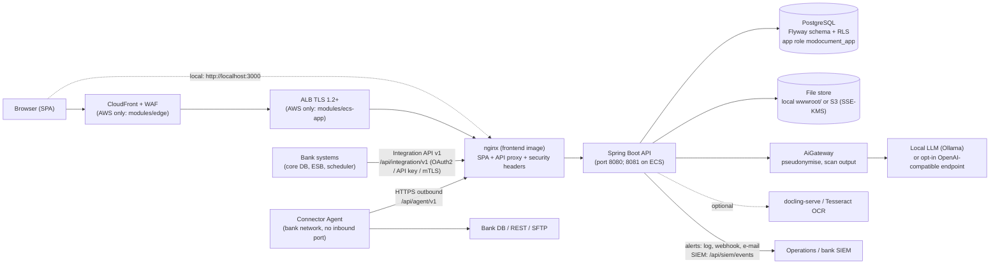

# MO-009 — Developer & Technical Documentation set

## Document control

| Item | Value |
|---|---|
| Task | MO-009 — Developer & technical documentation (checklist category: Documentation) |
| Deliverable | Developer & Technical Documentation set (this page and the five parts under `docs/compliance/dev/`) |
| Version | 1.0 (draft for review) |
| Date | 2026-10-19 |
| Prepared by | Agent A2 (documentation pack); human owner `TO CONFIRM (organisational)` — the checklist lists this document with no owner |
| Reviewer | Rushal (cross-check), as named in the checklist |
| DPO involvement | No (checklist) |
| Management approval | No (checklist) |
| Product version described | 1.2.0 (`pom.xml`, `frontend/package.json`, `CHANGELOG.md`; `scripts/check-version-sync.sh` reported them in sync on 2026-10-19) |
| Commands verified | See [evidence/A2-verified-commands.md](evidence/A2-verified-commands.md). Every command marked **verified** in this set was run in the development container on 2026-10-19. |

**Scope.** The checklist asks for: repository structure, development-environment setup, build and deployment procedure, configuration and secrets handling, API/interface reference, how a new client template is onboarded and trained, logging/monitoring, and backup/restore steps — enough for a new developer to run and maintain the platform. Each of these has a section below or in a part file.

**How to read the proof marks.** Every statement names a repository path in backticks. Facts the repository cannot prove carry `TO CONFIRM (organisational)` or `NOT IN REPO (live cloud)`.

## Audience

| Reader | Start with |
|---|---|
| New backend or frontend developer | §1–§3 here, then [Part 1: setup, build and test](dev/01-setup-build-test.md), then the first-day checklist (§5) |
| Release manager / operator | [Part 2: release, configuration and secrets](dev/02-release-config-secrets.md) and [Part 5: operations](dev/05-operations-logging-backup.md) |
| Integration engineer (bank IT, agent) | [Part 3: API and interface reference](dev/03-api-reference.md) |
| Implementation / onboarding staff | [Part 4: onboarding a client and its templates](dev/04-client-template-onboarding.md) |
| Reviewer (Rushal) | This page, §6 "Gaps and discrepancies" and the evidence file |

## The documentation set

| Part | Checklist topic | File |
|---|---|---|
| This page | System overview, architecture, repository structure, first-day checklist | `docs/compliance/mo-009-developer-technical-documentation.md` |
| Part 1 | Development-environment setup; build, test and quality gates; CI | [dev/01-setup-build-test.md](dev/01-setup-build-test.md) |
| Part 2 | Release and deployment; configuration and secrets handling | [dev/02-release-config-secrets.md](dev/02-release-config-secrets.md) |
| Part 3 | API / interface reference | [dev/03-api-reference.md](dev/03-api-reference.md) |
| Part 4 | How a new client and its templates are onboarded and "trained" | [dev/04-client-template-onboarding.md](dev/04-client-template-onboarding.md) |
| Part 5 | Logging and monitoring; backup and restore; troubleshooting / FAQ | [dev/05-operations-logging-backup.md](dev/05-operations-logging-backup.md) |
| Evidence | Every command run for this set, with date and result | [evidence/A2-verified-commands.md](evidence/A2-verified-commands.md) |

The existing engineering documents stay where they are and are linked, not copied: `README.md`, `docs/release/runbook.md`, `docs/release/migration-policy.md`, `docs/api/versioning-policy.md`, `docs/integration/developer-guide.md`, `docs/integration/agent.md`, `docs/integration/secrets.md`, `docs/settings/catalogue.md`, `docs/security/` and `infra/terraform/README.md`.

## 1. System overview

MoDocument turns documents (CSV, Excel, PDF, Word, images) into validated tables against user-defined templates, creates exact PDF documents from uploaded PDF templates, and connects to banks' systems through an integration hub (`README.md` "Features").

| Component | Technology | Proof |
|---|---|---|
| Backend API | Java 21, Spring Boot 3.5.3, Spring AI 1.0.1, one Maven module | `pom.xml` |
| Frontend | React 19, React Router 7, Vite 6, Tailwind 4, served by unprivileged nginx | `frontend/package.json`, `frontend/Dockerfile`, `frontend/nginx.conf` |
| Database | PostgreSQL (17 in compose and Terraform), schema by Flyway, tenant isolation by row-level security | `docker-compose.yml`, `infra/terraform/modules/rds/variables.tf`, `src/main/resources/db/migration/V13__rls_policies.sql` |
| File store | Local disk under `wwwroot` (default) or S3 (`MODOCUMENT_STORAGE_BACKEND=s3`, set on ECS) | `src/main/resources/application.yml` (`modocument.storage`), `infra/terraform/modules/ecs-app/main.tf` |
| AI | Local Ollama by default (`http://localhost:11434`, model `qwen2.5`); every call through one `AiGateway` | `src/main/resources/application.yml` (`spring.ai.openai`), `src/main/java/com/modocument/infrastructure/ai/AiGateway.java` |
| Connector library | DATABASE, REST_API, SFTP, WEBHOOK connectors shared by the server and the agent; a sibling Maven project | `connector-core/pom.xml`, `docs/integration/connector-sharing.md` |
| Connector Agent | On-prem Spring Boot service in the bank's network, outbound calls only | `agent/pom.xml`, `agent/README.md`, `docs/integration/agent.md` |
| Infrastructure as code | Terraform for AWS af-south-1; written and validated, **not applied** | `infra/terraform/README.md` ("Status") |

### Architecture

Proof for each arrow:

- nginx is the single entry point; the app port is not published, so nginx's overwrite of `X-Forwarded-*` can be trusted (`docker-compose.yml` `app` service comment; `frontend/nginx.conf`).
- On port 8080 the nginx API location proxies `/api`, `/oauth2`, `/login/oauth2` and the legacy CRUD prefixes (`frontend/nginx.conf`, `location ~ ^/(api|oauth2|…)`). A second server on 8443, the target of the ALB's optional mutual-TLS listener, serves only `/api/integration/` and `/api/agent/` (`frontend/nginx.conf`; `infra/terraform/modules/ecs-app/mtls.tf`; `frontend/Dockerfile` `EXPOSE 8080 8443`).
- On ECS, nginx and the app share one awsvpc task: nginx on 8080, the app on 8081 (`infra/terraform/README.md` "Layout", `ecs-app`).
- CloudFront + WAF → ALB → ECS on EC2 → Multi-AZ RDS (`infra/terraform/README.md`; `infra/terraform/modules/edge/main.tf`; `infra/terraform/modules/rds/main.tf`).
- The app connects as `modocument_app` (NOBYPASSRLS); Flyway migrates as the schema owner (`src/main/resources/application.yml` `spring.datasource` comment; `docker/postgres-init/01-app-role.sh`).
- One gateway for every LLM call; a guard test fails the build on any other class touching the Spring AI chat types (`README.md` "AI integration"; `src/test/java/com/modocument/infrastructure/ai/AiGatewayC9Test.java`).
- The agent long-polls `/api/agent/v1/tasks` and posts records/results (`docs/integration/agent.md` "Architecture").

## 2. Repository structure

### 2.1 Top-level directories and files

| Path | What it is |
|---|---|
| `src/` | Backend source. `src/main` (code and resources), `src/test` (unit and `*PgIT` tests), plus extra source sets added by Maven profiles: `src/scale` and `src/scale-test` (`-Pscale`, Mongo/Kafka extraction), `src/s3-it` (`-Ps3-it`), `src/connectors-it` (`-Pconnectors-it`) (`pom.xml` profiles) |
| `frontend/` | React SPA (`frontend/src`), its nginx image (`frontend/Dockerfile`, `frontend/nginx.conf`, `frontend/security-headers.conf`, `frontend/docker-entrypoint.d/`) and the Vite config (`frontend/vite.config.js`) |
| `agent/` | On-prem Connector Agent, a standalone Maven project with its own `agent/Dockerfile` and `agent/README.md` |
| `connector-core/` | Shared connector library (DATABASE, REST_API, SFTP, WEBHOOK); install it before building the app or the agent (`README.md` "Build & test") |
| `docs/` | Engineering documentation: `docs/api`, `docs/doccreation`, `docs/integration`, `docs/optimization`, `docs/phase2`, `docs/platform`, `docs/qa`, `docs/release`, `docs/security`, `docs/settings`, and this pack in `docs/compliance` |
| `infra/terraform/` | AWS Terraform: `infra/terraform/modules/` (network, rds, backups, ecs-app, edge, file-store, security-monitoring, ci-oidc) and `infra/terraform/envs/` (staging, production) |
| `e2e/` | Playwright end-to-end suite, the Docker-free runner `e2e/run-local.sh`, the fake LLM `e2e/stubs/fake-llm.mjs` and the bank simulator `e2e/bank-simulator/` (`e2e/README.md`) |
| `perf/` | Optimization-round measurement scripts and committed results (`perf/README.md`, `perf/results/`) |
| `loadtest/` | k6 load and stress scenarios for gate E7; not run in CI (`loadtest/README.md`) |
| `scripts/` | Version tooling (`scripts/bump-version.sh`, `scripts/check-version-sync.sh`, `scripts/version-lib.sh`), `scripts/check-nginx-headers.sh`, `scripts/dev-mtls-certs.sh`, release helpers in `scripts/release/`, and the pack checker `scripts/compliance/check_pack.py` |
| `docker/` | `docker/postgres-init/01-app-role.sh` (creates `modocument_app` on first boot) and `docker/keycloak/modocument-realm.json` (dev IdP realm) |
| `.github/` | CI/CD workflows in `.github/workflows/`, `.github/CODEOWNERS`, `.github/dependabot.yml`, `.github/pull_request_template.md` |
| `.semgrep/`, `.zap/`, `.gitleaks.toml`, `.gitleaksignore` | Semgrep custom rules (`.semgrep/modocument.yml`), ZAP baseline rules and seed (`.zap/rules.tsv`, `.zap/integration-seed.py`), gitleaks allow-lists |
| `Dockerfile`, `docker-entrypoint.sh` | Multi-stage backend image (RDS CA bundle stage, Maven build, Temurin 21 JRE runtime, uid 10001, healthcheck on `/actuator/health`) |
| `docker-compose.yml` | Local/production-style stack: `frontend`, `app`, `postgres`; optional profiles `ai-local` (Ollama), `docling`, `keycloak`, `extraction` (MongoDB + Kafka) |
| `docker-compose.e2e.yml`, `docker-compose.e2e-bank-sim.yml`, `docker-compose.mtls-dev.yml` | E2E stack for CI, the bank-simulator overlay, and the local mTLS listener |
| `.env.example`, `application-local-secrets.yml.example`, `application-oidc.yml.example` | Templates for local secrets and OIDC configuration; the real files are gitignored (`.gitignore` lists `.env`) |
| `CHANGELOG.md`, `SECURITY.md`, `README.md` | Release notes (also served in-app), vulnerability-reporting contact, product README |

### 2.2 Backend packages (`src/main/java/com/modocument`)

The README describes Clean Architecture layering by package (`README.md` "Architecture"). Package by package:

| Package | Contents (one line each) |
|---|---|
| `api/controller` | REST controllers (one per route family) and the exception handlers (`ApiExceptionHandler`, `IntegrationApiExceptionHandler`, `AiExceptionHandler`, `ConcurrencyExceptionHandler`, `SettingsExceptionHandler`) |
| `api/config` | `SecurityConfig` (filter chain, public routes), `OpenApiConfig`, `WebConfig`, deprecation headers, machine-API interceptor |
| `api/security` | `@RequiresPermission`, `PermissionChecker`, method security and denied-access audit |
| `application/dto` | Request and response records |
| `application/port` | Interfaces the use cases depend on (including `TenantContext` and `integration/SecretVault`) |
| `application/usecase` | Use cases (ingestion, templates, auto-mapping, users, settings, …) |
| `application/mapping` | Column-to-field mapping signals: name similarity, value-shape scoring, mapping settings |
| `application/validation` | Validation messages and helpers for the rule engine |
| `application/privacy` | PII patterns, masking and pseudonymisation used before prompts and in logs |
| `application/security` | `RolePermissions` (role → permission matrix), password and lockout policy, SoD policy |
| `application/audit` | Audit action catalogue (`AuditActions`) |
| `domain/entity` | JPA entities (PascalCase table names kept from the original schema) |
| `domain/model` | Enums and value objects (`Role`, `Permission`, `AuditAction`, `DbVendor`, …) |
| `domain/document` | Extraction documents (sources, jobs, tasks, records) |
| `doccreation/*` | Document creation (exact PDF templates): `api` controllers, `dto`, `entity`, `repo`, `usecase`, `pdftemplate` (PDF analysis, region detection, generation), `fields` (field properties and formatting), `rules` (document field rules) |
| `infrastructure/ai` | `AiGateway`, circuit breaker, output scanner, HTTP client timeouts, result cache |
| `infrastructure/prompt` | Prompt builders (extraction, auto-mapping, chat edit, schema inference, summaries, cleaning) |
| `infrastructure/file` | Parsers and OCR: Excel/CSV, PDF, Word, docling client, Tesseract (`OcrService`) |
| `infrastructure/file/store` | `FileStore` backends (local and S3) |
| `infrastructure/transform` | Parse stage: AI extraction, code extractor, extraction-mode resolution |
| `infrastructure/ingestion` | `IngestionJobRunner` (stage checkpoints) |
| `infrastructure/rule` | Validation rule strategies: `RegexRule`, `RequiredRule`, `DateFormatRule`, `ExpiryDateRule`, `RangeRule` |
| `infrastructure/export` | File and database export, per-role export caps |
| `infrastructure/extraction` | External-source extraction: SQL store, connectors, lease queue, worker pool, robots/rate-limit compliance |
| `infrastructure/integration` | Bank Integration Hub: connectors, flow engine, egress rules, agent protocol, `SecretVault` implementation, idempotency store |
| `infrastructure/security` | JWT, MFA, OIDC, client authentication, `RequestIdFilter`, `IdentityContextFilter`, `SecretFileEnvironmentPostProcessor` (`*_FILE` secrets) |
| `infrastructure/persistence` | Spring Data repositories and the tenant-aware data source/transaction manager |
| `infrastructure/settings` | Editable settings: `SettingDefinitions`, `SettingsCatalogue`, resolver, cache, `ConfigRevisionPoller`, startup guardrail check |
| `infrastructure/audit`, `alerting`, `siem`, `logging` | Audit writer, alert rules and channels, SIEM feed and webhook, log redaction |
| `infrastructure/retention`, `housekeeping`, `sod` | Scheduled jobs: retention purge, housekeeping, segregation-of-duties scan |
| `infrastructure/ratelimit` | `ApiRateLimitInterceptor` (per-user buckets) and auth/MFA limiters |
| `infrastructure/release` | Version, release notes and announcements (`SystemVersionService`, `DeployedVersionRecorder`) |
| `infrastructure/bootstrap` | `BootstrapAdminRunner` and `BootstrapPlatformRunner` (first-run accounts) |
| `infrastructure/platform`, `net`, `job`, `async` | Platform-bank lookups, outbound host policy (SSRF), job wait/long-poll, tenant-aware async decorator |

`src/main/resources` holds `application.yml` and the `local`, `scale` and `test` profiles, `logback-spring.xml`, `db/migration` (Flyway, with `RANGES.md`), `data.sql` (H2 test seed), bundled fonts and the common-password list.

Tests (`src/test/java/com/modocument`) mirror the packages and add `pgit` (real-PostgreSQL `*PgIT` suites), `integration`, `release` (`FlywayVersionRangeTest`, `MigrationPolicyTest`, version-script tests) and `testsupport`.

### 2.3 Frontend folders (`frontend/src`)

| Folder | Contents |
|---|---|
| `frontend/src/pages` | One component per route (e.g. `TemplatesPage.jsx`, `IngestionJobPage.jsx`, `BlueprintDetailPage.jsx`, `PlatformBanksPage.jsx`), each with its `*.test.jsx` |
| `frontend/src/components` | Shared UI: `Layout.jsx` (sidebar), `ProtectedRoute.jsx`, `DataTable.jsx`, `RegexBuilder.jsx`, wizards and dialogs; sub-folders `blueprint`, `dataTemplates`, `doc`, `mapping`, `pdf`, `records`, `rules` |
| `frontend/src/api` | One module per backend area (`client.js` is the shared HTTP client; `templates.js`, `ingestion.js`, `doccreation.js`, `integrations.js`, …) |
| `frontend/src/context` | `AuthContext.jsx` (session, refresh), `ToastContext.jsx` |
| `frontend/src/hooks` | `usePolling.js`, `useUnsavedGuard.js` |
| `frontend/src/utils` | Small helpers (database vendors, parse provenance, temporary passwords) |
| `frontend/src/test` | Vitest setup and render helpers |

Routes are declared in `frontend/src/App.jsx`; the sidebar sections (Document Flow, Document Creation, Data Extraction, Administration, Integrations, Platform) are in `frontend/src/components/Layout.jsx`.

## 3. Ten-minute orientation

1. Install the tools in [Part 1 §1](dev/01-setup-build-test.md#1-prerequisites).
2. `mvn -B -f connector-core/pom.xml install`, then `mvn -B verify` (README "Build & test").
3. Start PostgreSQL and the backend with the `local` profile, then the SPA with `npm run dev` ([Part 1 §2](dev/01-setup-build-test.md#2-running-the-platform-locally)).
4. Sign in with the bootstrap administrator; change the temporary password.
5. Create a template, set its field rules, upload a CSV ([Part 4](dev/04-client-template-onboarding.md)).

## 4. Where the rules live

| Topic | Authoritative source |
|---|---|
| Roles and permissions | `src/main/java/com/modocument/application/security/RolePermissions.java`, `docs/security/role-catalogue-and-sod.md`, `docs/security/role-permission-matrix.csv` |
| Migration rules | `docs/release/migration-policy.md`, `src/main/resources/db/migration/RANGES.md` |
| API contract | `/v3/api-docs` (generated), `docs/api/openapi-routes.txt`, `docs/api/versioning-policy.md` |
| Editable settings | `docs/settings/catalogue.md` (pinned by `SettingsCatalogueDocTest`) |
| Audit actions | `docs/security/audit-events.md` (pinned by `AuditActionCatalogueDocTest`) |
| Release process | `docs/release/runbook.md` |
| AWS topology | `infra/terraform/README.md` |

## 5. First-day checklist for a new developer

| # | Task | Done when | Reference |
|---|---|---|---|
| 1 | Get repository access and read `README.md`, `SECURITY.md` and this set | You can explain the architecture diagram above | §1 |
| 2 | Install Java 21, Maven 3.9, Node 22, a PostgreSQL client, Docker (optional) | `java -version`, `mvn -v`, `node -v` show the versions | [Part 1 §1](dev/01-setup-build-test.md#1-prerequisites) |
| 3 | Build `connector-core`, compile the backend and the agent | Both `mvn` commands exit 0 | [Part 1 §3](dev/01-setup-build-test.md#3-build-test-and-quality-gates) |
| 4 | Create `.env` from `.env.example` with generated secrets; never commit it | `git status` does not show `.env` | [Part 2 §6](dev/02-release-config-secrets.md#6-secrets-handling) |
| 5 | Run the stack (compose, or PostgreSQL + `mvn spring-boot:run` + `npm run dev`) | `/actuator/health` answers `{"status":"UP"}` | [Part 1 §2](dev/01-setup-build-test.md#2-running-the-platform-locally) |
| 6 | Sign in as the bootstrap admin, change the password, create a second user (maker/checker) | The second admin approves the change under Approvals | [Part 4 §2](dev/04-client-template-onboarding.md#2-users-and-roles) |
| 7 | Walk the Document Flow: template → field rules → upload a CSV → export | The job reaches `VALIDATED` and exports | [Part 4 §3–§5](dev/04-client-template-onboarding.md) |
| 8 | Run the frontend tests and build | `npm test` and `npm run build` exit 0 | [Part 1 §3](dev/01-setup-build-test.md#3-build-test-and-quality-gates) |
| 9 | Run one focused backend test (`OpenApiContractTest`) and read what it pins | Test passes | [Part 3 §1](dev/03-api-reference.md#1-openapi-contract) |
| 10 | Read the migration policy before writing any SQL | You know your Flyway range and the expand/contract rule | [Part 2 §2](dev/02-release-config-secrets.md#2-database-migrations) |
| 11 | Read the PR template and CODEOWNERS; open a small PR | CI (`ci.yml`, `security.yml`) is green | `.github/pull_request_template.md`, `.github/CODEOWNERS` |
| 12 | Know where logs, request ids and the audit trail are | You can find a request's `requestId` in the log and in the audit viewer | [Part 5 §1](dev/05-operations-logging-backup.md#1-logging) |

## 6. Gaps and discrepancies found while writing this set

These were found by checking the documents against the code on 2026-10-19. Items marked "fixed" were corrected in `README.md` in the same commit as this set; the others are for their owners.

| # | Finding | Proof | Status |
|---|---|---|---|
| 1 | README configuration table gave the extraction store default as `memory`; the code default is `sql` | `src/main/resources/application.yml` (`extraction.store: ${EXTRACTION_STORE:sql}`) | Fixed in `README.md` |
| 2 | README said the `local` profile adds "in-memory extraction" and a "dev JWT secret"; `application-local.yml` sets `extraction.store: sql` and commits no JWT secret | `src/main/resources/application-local.yml` | Fixed in `README.md`; the same "in-memory extraction" wording remains in a `docker-compose.yml` comment (owner to fix) |
| 3 | README "Database" section named only V1–V3; the chain now runs to V334 (58 versioned migrations applied on a fresh database, 2026-10-19 run) | `src/main/resources/db/migration/`; evidence file, command C7 | Fixed in `README.md` |
| 4 | README export table said "PostgreSQL/H2 database"; the vendors are POSTGRESQL, ORACLE, SQLSERVER, MARIADB | `src/main/java/com/modocument/domain/model/integration/DbVendor.java` | Fixed in `README.md` |
| 5 | README said image/scan OCR via the vision model follows from setting the AI key; vision OCR is off unless `OCR_VISION_ENABLED=true` | `docker-compose.yml` (`OCR_VISION_ENABLED`), `src/main/resources/application.yml` (`ocr.vision`) | Fixed in `README.md` |
| 6 | README listed the anonymous routes without `POST /api/integration/oauth/token` and `POST /api/agent/v1/enroll` | `src/main/java/com/modocument/api/config/SecurityConfig.java` | Fixed in `README.md` |
| 7 | README walkthrough `curl` calls to `localhost:8080` carry no bearer token and compose does not publish 8080 | `docker-compose.yml`; evidence C7 (anonymous call → 401) | Note added to `README.md` |
| 8 | Structured JSON logging exists but is opt-in (`structured-logs` profile); the Terraform envs leave `spring_profiles` empty, so ECS logs are the human-readable pattern | `src/main/resources/application.yml`, `infra/terraform/modules/ecs-app/variables.tf` | Open — owner `TO CONFIRM (organisational)` |
| 9 | The S3 file store (which also holds PDF templates, i.e. configuration) is versioned with 7-day non-current expiry but is not in the AWS Backup selection, which picks up the RDS instance only | `infra/terraform/modules/file-store/main.tf`, `infra/terraform/modules/backups/main.tf` (`aws_backup_selection`) | Open — see [Part 5 §3](dev/05-operations-logging-backup.md#3-backup-and-restore) |
| 10 | `infra/terraform/README.md` "Apply order" numbers step 6 twice | `infra/terraform/README.md` | Open (doc owner) |
| 11 | The `pom.xml` `connectors-it` profile comment places the `*ConnIT` classes under the `src/test/java` tree (package `connectorsit`); the source set is actually `src/connectors-it/java` | `pom.xml`, `src/connectors-it/java/com/modocument/connectorsit/DbConnectorConnIT.java` | Open (comment only) |
| 12 | `actionlint` is named as a gate in QA documents but is not run by any workflow; it was run by hand | `docs/release/runbook.md` §10, `.github/workflows/` | Open — decide whether to add it to CI |
| 13 | `.env.example` and README pre-fill a personal-looking e-mail address as the bootstrap admin | `.env.example` | Open — replace with a placeholder (`TO CONFIRM (organisational)`) |
| 14 | No springdoc groups are configured: there is one spec, organised by controller `@Tag` | `src/main/java/com/modocument/api/config/OpenApiConfig.java` | Information |
| 15 | README "Architecture" tree omitted the `doccreation` package | `src/main/java/com/modocument/doccreation/` | Fixed in `README.md` |
| 16 | README told developers to add a migration as `V<n>__description.sql`; the policy requires `V{n}__ws{NN}_{description}.sql` inside the workstream's range, expand-only | `src/main/resources/db/migration/RANGES.md`; `docs/release/migration-policy.md` | Fixed in `README.md` |

## 7. To confirm

- `TO CONFIRM (organisational)`: the human owner of this document set and its review cycle.
- `TO CONFIRM (organisational)`: who owns fixing open items 8–13 in §6, and by when.
- `TO CONFIRM (organisational)`: whether developers get access to the shared staging account, and through which process.
- `NOT IN REPO (live cloud)`: everything that depends on a deployed AWS environment — real deployments, CloudWatch logs and alarms, backups and a restore drill (see [Part 5](dev/05-operations-logging-backup.md)).
