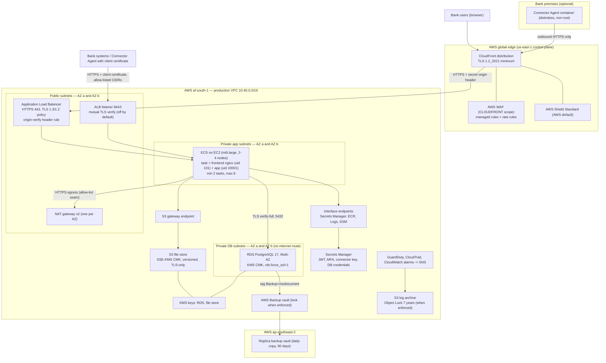
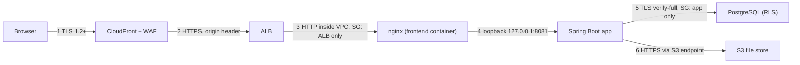
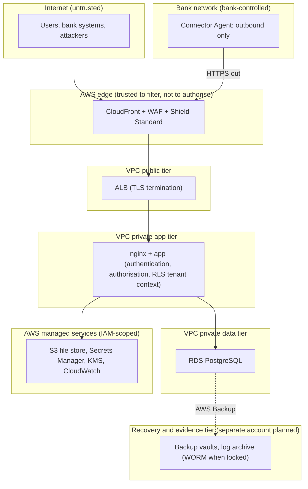
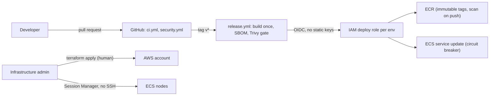

# MoDocument security architecture (SEC-001)

| Item | Value |
|---|---|
| Control | SEC-001 — Submit security architecture (on-premise, cloud, or hybrid); also used by SEC-004, SUP-S03, SUP-S06 |
| Owner | IT Infrastructure — Bhavish Nobeen |
| Version | 1.0, written 2026-10-19 by agent A8 from the repository; human review required |
| Review | Annually and on every infrastructure change (workbook evidence frequency) |
| Status of the system | **Pre-production.** The design is written in Terraform and validated (`docs/compliance/evidence/A8-infra-checks.md` §1). Nothing is applied to AWS. Every live fact is `NOT IN REPO (live cloud)`. |

## 1. Summary

MoDocument is a **hybrid** system:

- **Cloud (AWS, Cape Town `af-south-1`)**: the web application, its API, the
  PostgreSQL database and the file store. All built from
  `infra/terraform/` (fact IDs TF-nn in
  [A8-infra-checks.md](../evidence/A8-infra-checks.md)).
- **On premises at a bank (optional)**: the Connector Agent, a container the
  bank runs inside its own network. It dials **out** to MoDocument over HTTPS
  and needs no inbound path (`docs/integration/agent.md`, `agent/Dockerfile`).

Identity for users comes from the app's own login (with MFA) or from an
OIDC identity provider (`docs/security/identity-providers.md`). The design
statement of 2 Oct 2026 names Microsoft Entra ID for Microsoft banks; that
tenant is `TO CONFIRM (organisational)`.

## 2. Network and hosting

Sources for every box:

| Box | Terraform | Fact IDs |
|---|---|---|
| Region, edge region, DR region | `infra/terraform/envs/production/providers.tf` | TF-01, TF-02, TF-03 |
| VPC, subnets, two AZs, NAT, DB route table | `infra/terraform/modules/network/main.tf` | TF-10 to TF-13 |
| Security groups | `infra/terraform/modules/network/main.tf`, `infra/terraform/modules/edge/main.tf` | TF-14 to TF-16, TF-85 |
| VPC endpoints | `infra/terraform/modules/network/main.tf` | TF-17 |
| CloudFront, WAF, origin lock | `infra/terraform/modules/edge/main.tf` | TF-80 to TF-85 |
| ALB, listeners, mTLS listener | `infra/terraform/modules/ecs-app/main.tf`, `infra/terraform/modules/ecs-app/mtls.tf` | TF-71, TF-72, TF-75 |
| ECS cluster, nodes, tasks, autoscaling | `infra/terraform/modules/ecs-app/main.tf` | TF-60 to TF-70, TF-73, TF-74 |
| RDS | `infra/terraform/modules/rds/main.tf` | TF-20 to TF-31 |
| File store | `infra/terraform/modules/file-store/main.tf` | TF-50 to TF-54 |
| Backups, log archive | `infra/terraform/modules/backups/main.tf` | TF-40 to TF-46 |
| GuardDuty, CloudTrail, alarms | `infra/terraform/modules/security-monitoring/main.tf` | TF-90 to TF-97 |
| Secrets | `infra/terraform/envs/production/main.tf` | TF-08 |
| CI deploy identity, ECR | `infra/terraform/modules/ci-oidc/main.tf` | TF-100 to TF-102 |

Not in Terraform (see [A8-infra-checks.md](../evidence/A8-infra-checks.md) §3, "Absent"):
Route 53 DNS and ACM certificates (created by hand, TF-110, TF-111); the two
GPU model servers named in the 2 Oct design statement (TF-112); Shield
Advanced (not chosen, TF-113).

Staging is the same modules in a separate AWS account, scaled down, with no
CloudFront or WAF, one NAT gateway, a single-AZ database and no backup locks
(`infra/terraform/envs/staging/main.tf`, TF-04, TF-07).

## 3. Request path and the control at each hop

| Hop | Control | Proof |
|---|---|---|
| 1 Browser → CloudFront | TLS `TLSv1.2_2021` minimum; HTTP redirected to HTTPS; WAF managed rules and per-IP rate rules | TF-80 to TF-84 |
| 2 CloudFront → ALB | HTTPS only to the origin, certificate checked against the app domain; ALB SG admits only the CloudFront origin-facing prefix list; a listener rule demands the secret origin header, everything else gets 403 | TF-84, TF-85 |
| 3 ALB → nginx | App SG admits only the ALB SG on 8080; nginx runs as uid 101 with no capabilities; nginx overwrites `X-Forwarded-*` and drops client `Forwarded` headers | TF-15, TF-68; `frontend/nginx.conf`; `scripts/check-nginx-headers.sh` |
| 4 nginx → app | The app listens only inside the task network namespace; JWT authentication, role permissions, rate limits, audit trail | `src/main/java/com/modocument/api/config/SecurityConfig.java`; `src/main/java/com/modocument/infrastructure/ratelimit/ApiRateLimitInterceptor.java` |
| 5 app → PostgreSQL | DB SG admits only the app SG; server forces TLS; the app verifies the server certificate (`sslmode=verify-full` with the RDS CA bundle baked into the image); the runtime role `modocument_app` has DML only and is subject to row-level security | TF-14, TF-23; `infra/terraform/envs/production/main.tf` (`db_jdbc_url`); `src/main/resources/db/migration/V12__app_role_grants.sql`; `src/main/resources/db/migration/afterMigrate__rls_enforce.sql` |
| 6 app → S3 | Gateway endpoint (no NAT); bucket policy denies non-TLS and non-KMS writes; task role limited to this bucket and key | TF-17, TF-52, TF-66 |

Machine clients that use a client certificate go straight to the ALB's
8443 listener (CloudFront cannot carry a client certificate). That listener
verifies the chain against the banks' issuing CAs and admits only
allow-listed networks; it is **off by default** (TF-75). It is not behind
the WAF.

## 4. Trust boundaries

| Boundary | What crosses it | What protects it |
|---|---|---|
| T0 → T1 | All user traffic | TLS, WAF rules, rate rules, Shield Standard |
| T1 → T2 | Only CloudFront traffic carrying the origin header | Prefix-list SG + listener rules (TF-85) |
| T2 → T3 | HTTP from the ALB only | App SG (TF-15); nginx trusted-proxy mode |
| T3 → T4 | PostgreSQL from the app SG only | DB SG, TLS forced, RLS (TF-14, TF-23) |
| T3 → T5 | AWS API calls | Task and execution roles scoped to exact ARNs (TF-65, TF-66) |
| T4 → T6 | Snapshots and copies | AWS Backup service role; vault lock when enforced (TF-41) |
| T7 → T1 | Agent's outbound HTTPS | Single-use enrolment token, then client credentials or mTLS (`docs/integration/agent.md`) |

The planned **lock account** (T6) does not exist yet. Until it does, the
log archive and the backup vaults sit in the production account
(`infra/terraform/README.md`, "The two-account model").
`TO CONFIRM (organisational)`: creation date of the lock account.

## 5. CI/CD and administrative access

- CI assumes a per-environment role through GitHub OIDC; the role can push
  two images and roll one service, nothing else (TF-100 to TF-102;
  `.github/workflows/release.yml`, `.github/workflows/deploy.yml`).
- Infrastructure changes are applied by a person running Terraform (no
  plan/apply pipeline exists, `infra/terraform/modules/ci-oidc/main.tf`
  header).
- Nodes have no SSH key; shell access is Session Manager only (TF-61, TF-64).

## 6. Hardening baseline

| Layer | Baseline in the repo | Proof | Open |
|---|---|---|---|
| Node OS | AWS ECS-optimised Amazon Linux 2023 AMI; IMDSv2 only; encrypted root volume; no SSH key; privileged containers disabled | TF-60, TF-61 | CIS benchmark scan of the node image: `NOT IN REPO (live cloud)`. No golden-image pipeline exists: the AMI is AWS's, not built by MO. No CIS scan workflow exists in `.github/workflows/`. |
| Containers | Non-root users, all capabilities dropped, `no-new-privileges`, weekly rebuild and Trivy scan, release gate on fixable HIGH/CRITICAL | TF-68; `Dockerfile`; `frontend/Dockerfile`; `.github/workflows/image-rebuild.yml`; `.github/workflows/release.yml` | See SUP-S04 |
| Database | Private, TLS forced, DDL logging, DML-only runtime role | TF-23, TF-24; `src/main/resources/db/migration/V12__app_role_grants.sql` | See SUP-S06 |
| Edge | WAF managed rules, rate rules, origin lock | TF-80 to TF-85 | See SUP-S03 |
| Detection | GuardDuty, CloudTrail, alarms | TF-91 to TF-95 | Defects DEF-2, DEF-3 in [A8-infra-checks.md](../evidence/A8-infra-checks.md) |

## 7. Known gaps in this architecture

Taken from [A8-infra-checks.md](../evidence/A8-infra-checks.md) §4:

1. DEF-1: production interface endpoints use the app SG, which blocks 443
   to the endpoints. This must be fixed before the first apply.
2. DEF-2, DEF-3: alert delivery and GuardDuty protection features.
3. DEF-4: the file store has no backup copy.
4. The egress allow-list (gate D3) is not narrowed: app HTTPS egress is
   `0.0.0.0/0` (TF-16).
5. The lock account (gate A6) does not exist.
6. GPU model servers are not in IaC (TF-112).
7. A CIS scan of the node image has never been run.

## 8. Related

- Controls: SEC-004 (HA/DR), SUP-S03 (DDoS), SUP-S04 (containers),
  SUP-S06 (database) in `docs/compliance/controls/`.
- `infra/terraform/README.md`: apply order, two-account model, proxy chain.
- `docs/security/web-hardening.md`, `docs/security/threat-control-matrix.md`.
