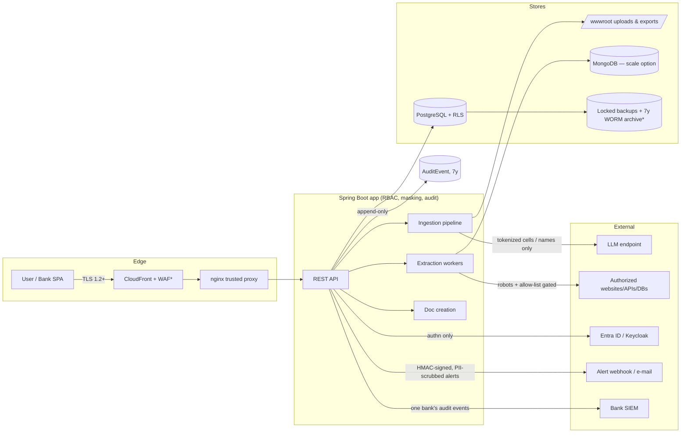

# Data inventory — PRIV-001

Every data category MoDocument holds, derived from the **actual schema**
(Flyway migrations V1–V161) and storage code — not from aspiration. Columns:
where it lives, how long (per [retention-and-dsr.md](retention-and-dsr.md)),
and what protects it. Last reviewed: 2026-10-09 (integration of workstreams 16–20).

## Inventory

| # | Category | Contents (schema source) | Storage | Retention | Protection |
|---|---|---|---|---|---|
| 1 | Banks (tenants) | Bank name/config (`Bank`, V11) | PostgreSQL | Life of contract | RLS tenant root; admin-only writes |
| 2 | User accounts | Email, display name, role, Argon2id password hash, lockout state (`AppUsers`, V1/V10/V40/V70); OIDC identity links (V50) | PostgreSQL | Account life; leavers disabled (dual control), PRIV-017 | Argon2id; maker/checker on create/role/disable; per-bank admin scope; masked in exports |
| 3 | MFA material | AES-256-GCM-encrypted TOTP secrets, Argon2id-hashed recovery codes (V41) | PostgreSQL | With the account | `MfaSecretCipher` (key: `MODOCUMENT_MFA_KEY`); never logged |
| 4 | Session tokens | Rotating refresh-token families stored as SHA-256 hashes, revoked jtis (V15) | PostgreSQL | 7 days absolute / revocation | Hash-only storage; rotation refuses replay |
| 5 | Templates & rules | Field definitions incl. per-field `PiiKind` tags, validation rules (V1, V100) | PostgreSQL | Configuration — kept | RLS + `template:write`; maker/checker on update/delete |
| 6 | Uploaded documents (originals) | Customer files on disk + `UploadedFile` rows with SHA-256 (V20/V31) | `wwwroot/uploads` volume + PostgreSQL | **30 days** from upload | Owner-scoped; content gate; non-root container; volume in prod design |
| 7 | Parsed/mapped/validated rows | `IngestionJob` JSON checkpoints (V1/V5/V7) — contains customer cell values | PostgreSQL | **30 days** from last update (nulled; skeleton kept) | RLS; masking on read channels; optimistic locking |
| 8 | Export copies | `wwwroot/exports/u{owner}/…` | Disk volume | **30 days** (with their job) | Owner-pathed; masked values per C2 |
| 9 | Extraction sources/jobs | Source configs (allow-lists, env-var credential *references* only), job state (V1 extraction tables / Mongo) | PostgreSQL or MongoDB (`extraction.store`) | Config kept; see 10–11 for payloads | Per-user ownership; secrets never persisted |
| 10 | Extraction raw captures | Fetched page/API/DB payloads (`ExtractionRawRecord.Body`) | PostgreSQL/Mongo | **30 days** (body nulled, fetch metadata kept) | RLS (SQL store); compliance gate ahead of every fetch |
| 11 | Extraction processed records | Normalized rows (`ExtractionProcessedRecord.FieldsJson`) | PostgreSQL/Mongo | **30 days** (nulled) | RLS; PII tokenization before any LLM cleaning |
| 12 | Doc-creation blueprints | Company .docx structure + sections (V9/V90) | PostgreSQL + disk | Configuration — kept (no customer data) | Owner-scoped |
| 13 | Doc-creation content | User paragraphs/images, generated docx/pdf (V9) | PostgreSQL + disk | **30 days** after last update | Owner-scoped; release needs four-eyes |
| 14 | Audit trail | Append-only `AuditEvent`: actor, bank, action, old/new values (truncated at 64 KB), jti, requestId, IP (V14) | PostgreSQL → 7y archive (IaC) | **7 years** (SEC-033) | Append-only (DB-enforced); RLS; WORM S3 archive 🏗️ |
| 15 | Application logs | Redacted app/nginx logs | CloudWatch (IaC) / container stdout | 400d hot, 7y archive (IaC) | Redacting converters (`LogRedactionCanaryTest`); no raw PII by design |
| 16 | Pending changes / SoD findings | Maker/checker queue (V80), SoD scan results | PostgreSQL | Governance records — kept | RLS; approval permissions |
| 17 | Backups | RDS snapshots + vault recovery points | AWS Backup (IaC) | **90 days**, cross-region | Vault lock (compliance) 🏗️; KMS |
| 18 | Security alerts (ws18) | `AlertLog` (V160): rule, severity, PII-scrubbed summary, event count, audit-event id, delivery channels/status/timestamps — ids, never values or export reasons | PostgreSQL | With the audit trail (**7 years**) | RLS (bank-scoped, `RlsPolicyCoveragePgIT`); admin-only read (`GET /api/admin/alerts`) |
| 19 | SIEM feed / pushes (ws18) | No new store: the bank-scoped `GET /api/siem/events` NDJSON feed and the optional single-bank webhook push are **views of row 14** (ECS-mapped, [siem-event-schema.md](siem-event-schema.md)); V161 adds indexes only | — (read from PostgreSQL; pushed to the bank's SIEM) | Recipient's retention | `SIEM_READ` (ADMIN-only), bank from the token + RLS (`SiemFeedE6Test`); HMAC-signed push |

**What MoDocument deliberately does NOT store:** raw passwords (hash only),
raw refresh tokens (hash only), plaintext TOTP secrets, per-run
export/extraction DB credentials (memory only), LLM API keys (env/Secrets
Manager only), payment data (none in scope).

## Data flow (DFD)

`*` = exists as Terraform (`infra/terraform/`), not yet applied.

Notes on the LLM edge: every model call goes through the ws15 `AiGateway`
(pseudonymised prompts, the one-bank rule, output scanning, local Ollama by
default — [ai-controls.md](ai-controls.md)); vision OCR is off by default
because page images cannot be pseudonymised. The residual risks (shape-driven
pseudonymisation, no input cleaning, model-written figures, no model pinning)
are listed in ai-controls.md for the C11 acceptance item in the README
later-table.

Related: [masking-matrix.md](masking-matrix.md) ·
[retention-and-dsr.md](retention-and-dsr.md) ·
[dpia-template.md](dpia-template.md)
